# Production One

**Your AI Production Department.** A Windows desktop studio for directors and producers: read the story, build the production bible, make consistent reference sheets, plan shots, generate storyboard frames, check continuity, play an animatic and deliver a package, with cloud models or AI running on your own computer.

Built with Tauri 2 (Rust), React and TypeScript. Projects are saved as `.pone` files; older Production Guy `.pguy` projects still open and are never overwritten.

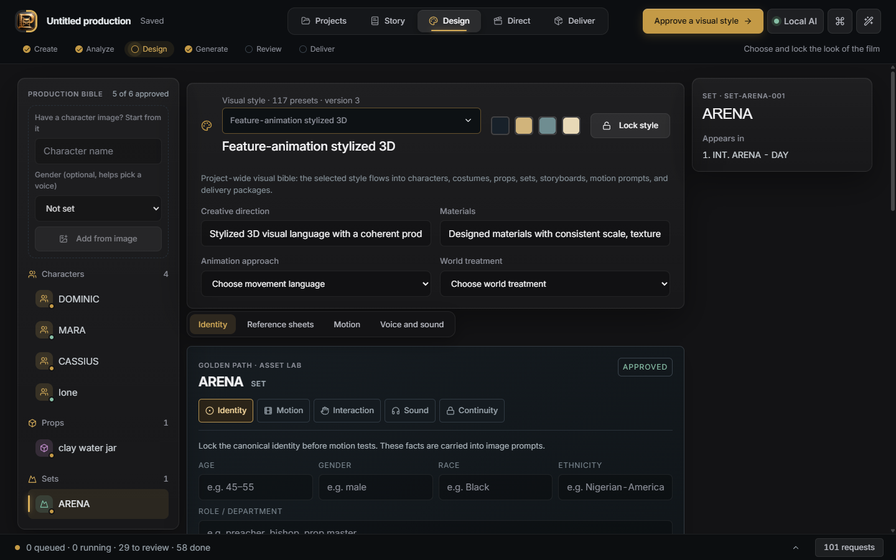

## What it does

| Step | What you get |
|---|---|
| **Create / Story** | A cast board of every character, prop and set as pictures, each beside what the script says about it. Paste or import a script (`.txt`, `.md`, Fountain, Final Draft `.fdx`, Word `.docx`, PDF). The reader finds scenes, characters, props, story variants (wardrobe, injury, age) and emotions, and shows the line each finding came from. |
| **Design** | A production bible, a style bible, and reference sheets per character, prop and set (turnarounds, expressions from the story's feelings, poses, wardrobe, details; multi-view, functional and detail sheets for props; establishing, interior, exterior, plan and lighting for locations). **Start a character from an image you already have** (for example a Midjourney render) and build every sheet from it. Per-sheet **Shape** and **Backdrop**, one-image **sheet export**, a personality and a "never drift" list per character. Approved front views become the anchor that keeps later views consistent, including the Wardrobe sheet. Image quality (CleanRender) checks colour casts, clipping, noise, bloom and sharpness and corrects them as separate revisions. |
| **Motion, voice and music** | Turntable, walk, run and speaking clips from a character's approved front view; voice auditions with Windows voices, ElevenLabs, VoiceKiller or a local server, and a fixed **casting line** so voices are compared on the same words. **Design a voice** from a description written from the script or by your local AI helper (ElevenLabs Voice Design, Qwen TTS). **Make music with Suno** (through Kie.ai) for a character theme or a scene score. |
| **Review** | Every picture waiting for a decision, large, beside the approved reference it has to match; technical checks kept apart from Approve, Request changes and Reject. |
| **Direct** (optional) | The Director's room: coverage planned per scene, a shot editor (camera, composition, blocking, cast and wardrobe, lighting, performance, audio), storyboard frames from your approved references, continuity checks and an animatic. |
| **Deliver** | A package checklist where every open line has a button to its fix, verified or draft packages, failed views grouped by cause with the fixes that can help, a Tasks list by role, and an optional shot compiler with an editable prompt for Seedance, Kling and Veo. |

**Appearance.** Three looks (Cinematic by default, Studio, Futurist), each in dark and light, chosen from the palette icon in the sidebar. **Look.** A gallery of 117 visual styles, each with its own picture of the same scene, searchable, filterable by family, with favourites. **Navigation.** One sidebar; Alt+1 to Alt+6 switch workspace.

**Models.** Kie.ai (59 image and 47 video models read live), Google Gemini, OpenAI, OpenRouter, fal.ai, and local ComfyUI, Ollama and LM Studio. One searchable picker; any model id can be typed. Cost never interrupts you: an optional spending cap lives in the queue dock.

**Local AI, no internet.** Production One finds Ollama, LM Studio and ComfyUI on your machine, can install ComfyUI and download SDXL and Wan 2.2 5B for you, and runs images, video and the optional AI story pass offline.

## Screenshots

| | |
|---|---|
| 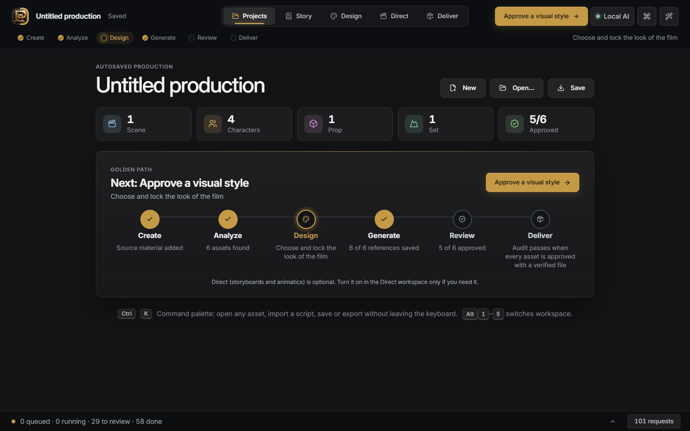 **Projects** and the Golden Path | 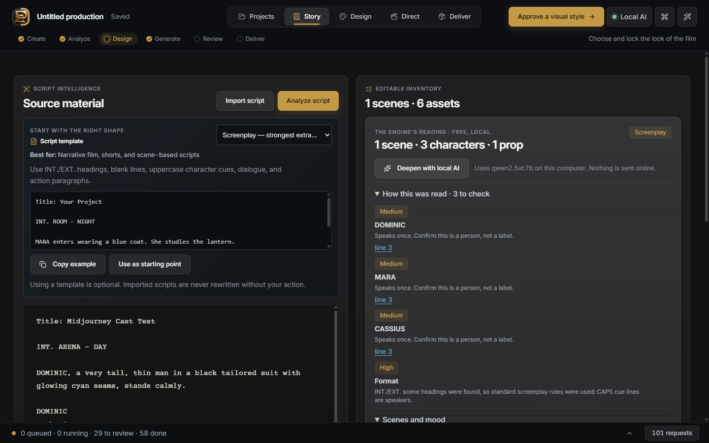 **Story**: script, reading, inventory |
| 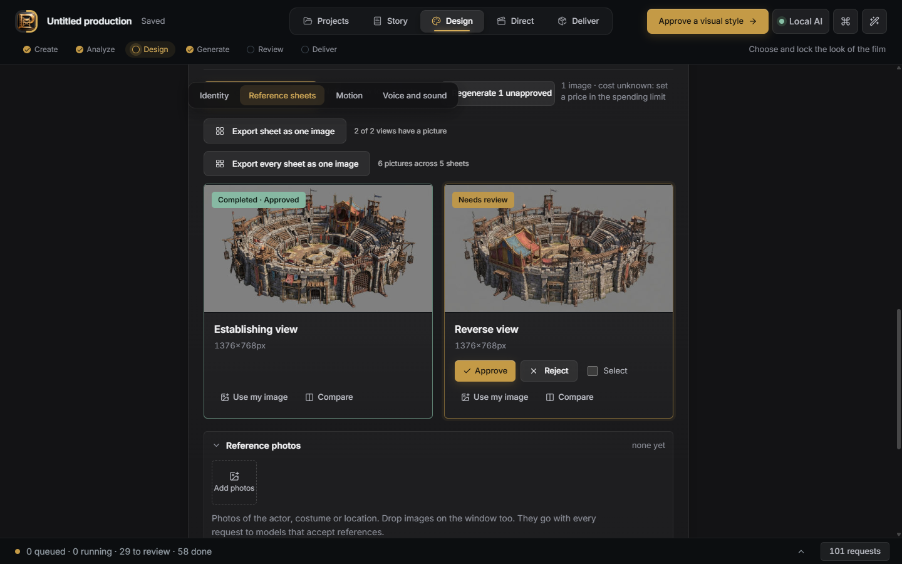 **A location's sheet** | 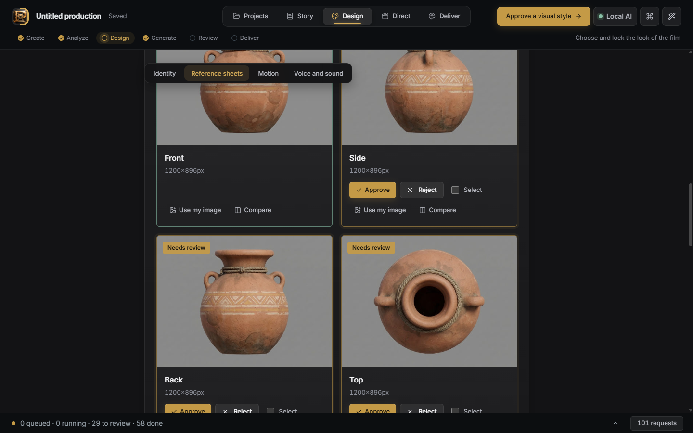 **A prop's sheet**, thumbnails in the sheet's own shape |
| 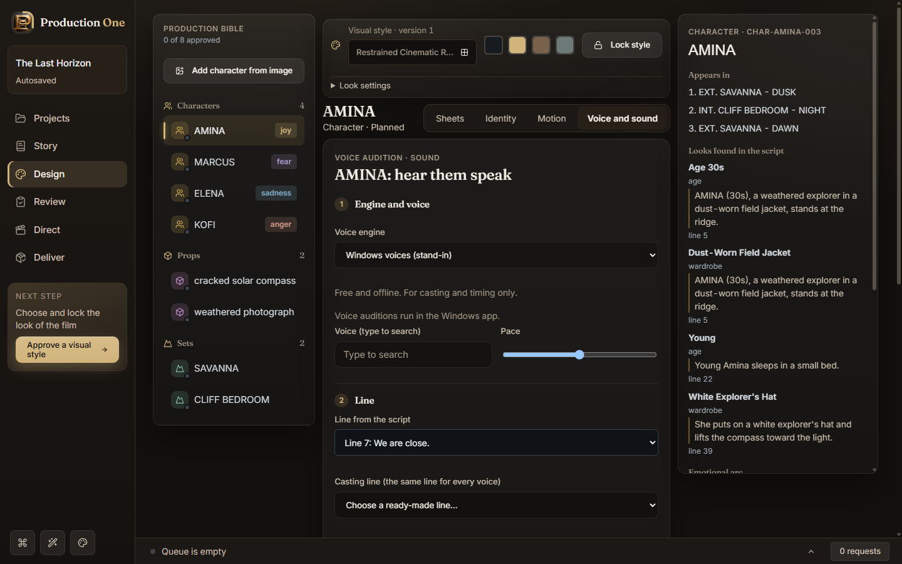 **Voice audition** with casting lines | 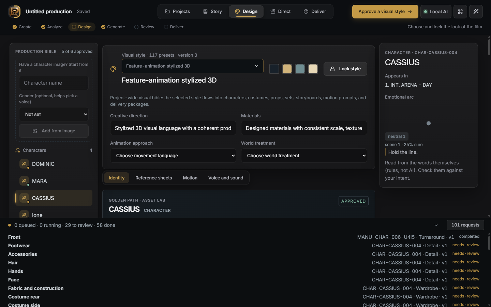 **The queue** |
| 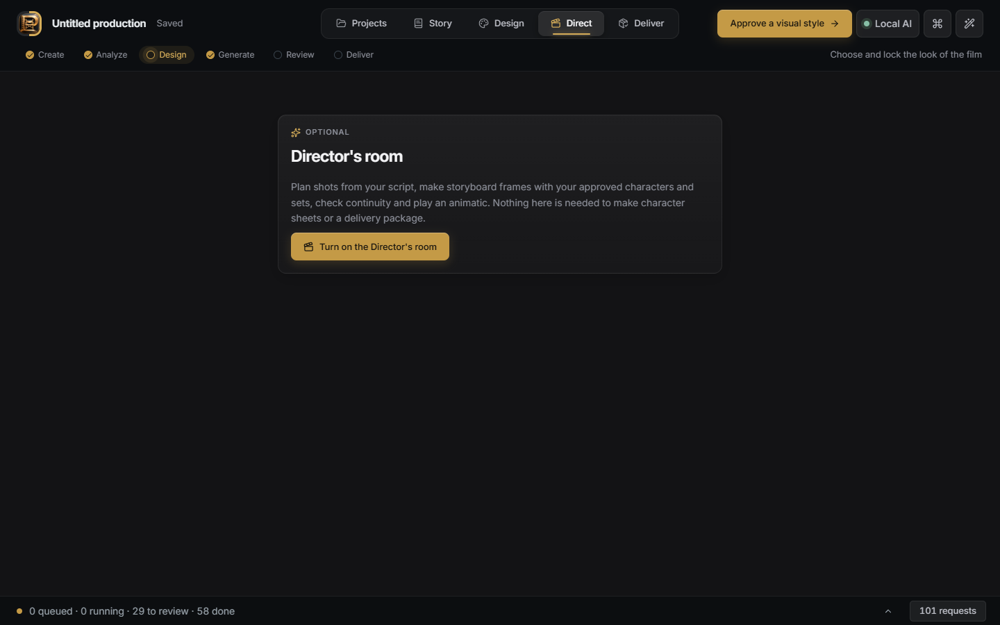 **Direct** | 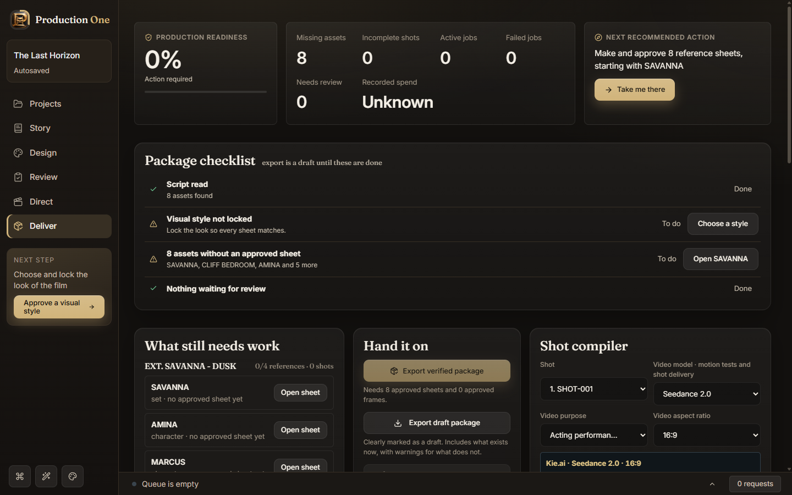 **Deliver** |
| 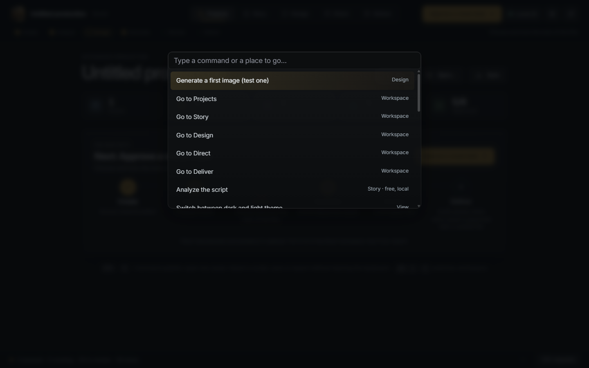 **Command palette** (Ctrl+K) | 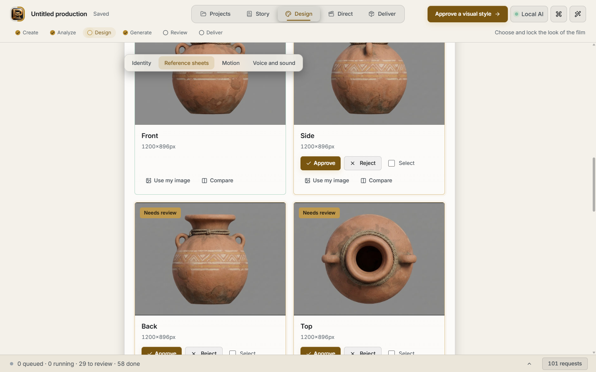 **Light theme** |

## Install

Download `Production One_<version>_x64-setup.exe` (or the `.msi`) from the [latest release](https://github.com/Olusegune/productionOne/releases), run it, and open Production One from the Start menu. The installer registers `.pone` and `.pguy` so double-clicking a project opens it.

Windows 10 or 11 with WebView2 (included in Windows 11; the installer adds it on Windows 10).

## First five minutes

1. **Providers** (sidebar, bottom): paste a key for one provider. Keys are stored in the Windows credential store, never in project files.
2. **Story**: paste a script or choose **Import script**, then **Analyze script**.
3. **Design**: approve the visual style, pick a character, choose a model, press **Generate**. Use **Test one first** to check the look cheaply.
4. Approve the front view; the other views use it as their reference.
5. **Direct → Plan all scenes**, then **Generate frames**. **Deliver** shows what is left.

No key? Open **Local AI** (sidebar, bottom) and let it find or install ComfyUI.

## Develop

```powershell
npm install
npm run dev            # browser preview (plans only; generation needs the desktop app)
npm run desktop:dev    # desktop app with hot reload
npm test               # 360+ unit, component and stress tests
npx tsc -b             # the real type check (tsc --noEmit -p . checks nothing here)
cargo test --manifest-path src-tauri/Cargo.toml
npm run desktop:build  # installers under src-tauri/target/release/bundle/
python scripts/make-icons.py   # rebuild icons from branding/
```

Architecture and status log: [docs/PRODUCTION_ONE_PLAN.md](docs/PRODUCTION_ONE_PLAN.md). Testing and what is not covered: [docs/TESTING.md](docs/TESTING.md). Latest QA run: [docs/QA_REPORT_0.40.0.md](docs/QA_REPORT_0.40.0.md). Design principles: [docs/DESIGN.md](docs/DESIGN.md). Security and privacy: [SECURITY.md](SECURITY.md). Using the app: [docs/USER_GUIDE.md](docs/USER_GUIDE.md). Changes: [CHANGELOG.md](CHANGELOG.md).

## Honest limits

- AI images can have wrong hands, drifting faces and plastic skin. Production One reduces these (prompt guidance, anchors, checks) and tells you when a filter cannot help; it does not remove them.
- Cloud generation costs money at your provider. Production One never states prices; set your own cap if you want one.
- The installer is not code-signed yet, so Windows SmartScreen may warn on first run.
- A second copy of the app cannot run beside the first, and all copies share one data folder.
- Draft casting lines for Nigerian Pidgin, Yoruba, Igbo and Hausa were not written by a native speaker; have one check them.

### Delivery modes

Desktop package export is explicit: incomplete projects are exported as `draft` and include an incomplete-reference report. A `verified` export is rejected when referenced media is missing, and deliveries never silently overwrite an earlier ZIP. The app validates the manifest and required package records; provider billing and remote-task reconciliation remain provider-dependent.
