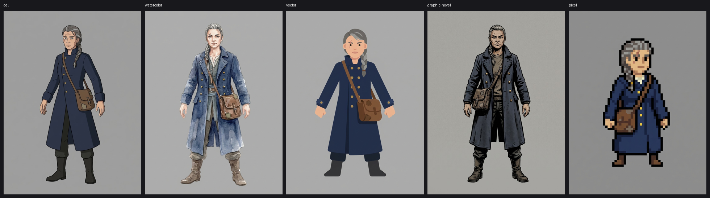
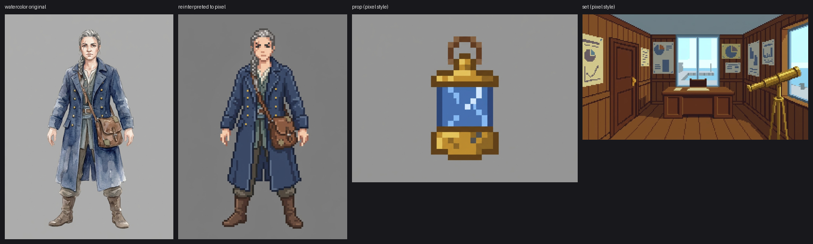
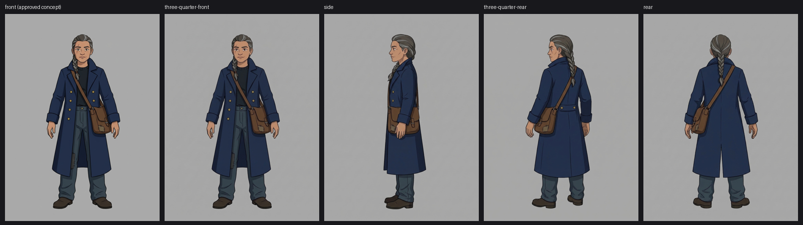
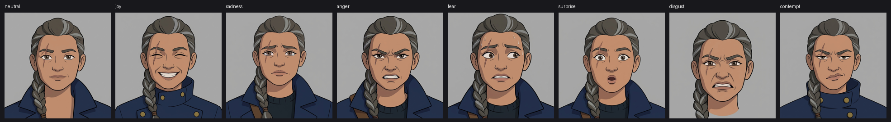
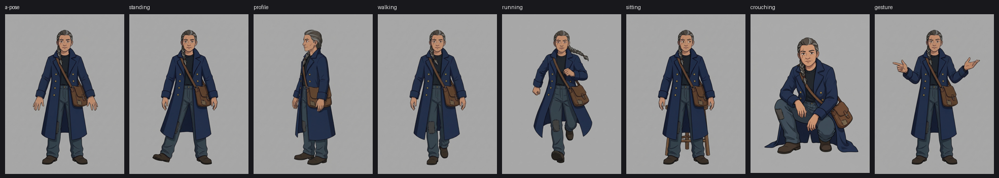
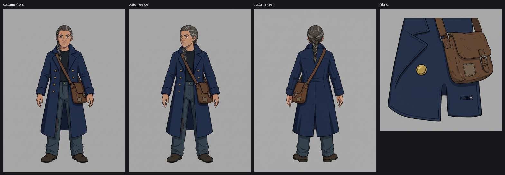
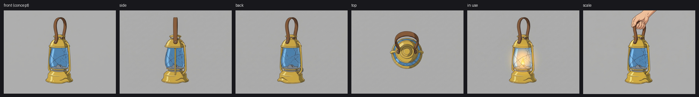
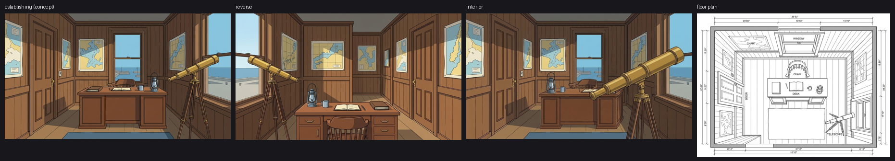

# 2D styles: live test, 2026-11-19

A real image model was used, through the app (an isolated test copy, a new empty project), to see whether the 2D styles do what they say. **Model:** Kie.ai, `google/pro-image-to-image`. **Requests:** 9, each pressed from a button in the app ("Add and make a first concept", or Reinterpret). Pictures are in `docs/screenshots/2d-live/`.

## 1. One character, five styles
The same description each time: *a weathered harbour pilot in her thirties with a short grey-streaked braid, a long navy coat with brass buttons, a patched leather satchel and a small scar through her left eyebrow.* The only thing changed was the project style. Each picture is the front view of a turnaround sheet.

| Style | What came back | Verdict |
|---|---|---|
| Clean digital cel animation | Smooth even outlines, flat fills, one shadow shape, flat grey background | Style followed |
| Watercolor Storybook | Transparent washes, pigment pooling, unpainted paper showing, soft edges | Style followed; texture kept on purpose |
| Flat vector | Solid shapes, no outline, no gradients, simplified face and hands | Style followed |
| Graphic novel | Inked line with weight variation and hatching, muted colour | Style followed |
| Low-resolution pixel art | Coherent blocky pixels and a small palette | Style followed; the pixels are the model's own drawing, not a true pixel grid |

**What held in all five:** a plain flat neutral background, no scenery, no cast shadow, no photographic skin or lens look, the braid, the navy coat with brass buttons and the satchel. **What did not show:** the small scar through the eyebrow was not visible in any of them (it is a very small detail), so the character's identity details were followed except that one.

## 2. Style change, then Reinterpret
The project style was changed to pixel art after the watercolour character existed. The app marked the earlier picture **"Made in Watercolor Storybook: out of date"** and did not change its approval. **Reinterpret in Low-resolution pixel art** then made a second revision from the approved watercolour picture; the original stayed approved.

The reinterpreted picture kept the grey braid, the navy coat with brass buttons, the satchel and the proportions. Identity carried over well **in this one test**; the app does not promise it will.

## 3. A prop and a place from a description
*Brass lantern* (a squat brass storm lantern with a cracked blue glass shade) came back as a clear pixel-art lantern with a blue shade. *Harbour office* was given a layout (*door on the left wall, a large desk in the centre facing the door, a tall window directly behind the desk, the brass telescope in the right corner by the window*). The picture put the door on the left, the desk in the centre, the window behind it and the telescope in the right corner. **Followed on this one picture. Consistency across several views of the place was not tested.**

## What was not tested
- Only five of the 38 presets (the other 33 are marked unverified).
- Only one model, and only one view of each subject. The turnaround views after the front, expressions, poses, costume sheets and a second view of the place were **not** generated, so sheet-to-sheet consistency, linework and palette across a whole sheet are **unchecked**.
- Whether the same results hold on OpenAI, Gemini, fal.ai or OpenRouter models.
- True pixel-grid accuracy.

---

# Part 2: the whole in-app workflow, one style (Clean digital cel animation)

The third way to start, with **no script and no image supplied**: everything made in the app. Same isolated test copy, a new empty project, the project style set to *Clean digital cel animation*, the same model (Kie.ai `google/pro-image-to-image`). **Requests:** about 35 image requests (the character 25, the prop 6, the place 4). The ten that failed (see below) failed before reaching the image model, so they were retried, not repeated.

## What was done, and where
1. **Add to the bible** > type *Mira* + a description > **Add and make a first concept** (one request). The picture came back as the front view of her turnaround.
2. **Approve** it (it becomes the reference everything else is built from).
3. For each sheet, press its button (the sheet buttons with icons) and **Generate N views**: Turnaround (4 more), Expressions (8), Poses (8), Wardrobe (4). Every one was built from the approved front view.
4. Same for a prop (*Brass lantern*: Multi-view 3 more, Functional 2) and a place (*Harbour office* with a written layout: Establishing 1 more, Interior 1, Layout 1).

No script and no supplied image were needed at any point.

## What came back
**Turnaround** (front, three-quarter front, side, three-quarter rear, rear): the same woman in the same coat, the same braid, the same satchel, the same clean outline and flat fills in all five. The rear views were **redrawn** (back vent, belt tab, strap crossing the back), not mirrored.

**Expressions** (8): one identity, one line quality, one palette; the scar through the left eyebrow, absent from the earlier front views, appears in all eight. The *disgust* face is framed without the coat collar.

**Poses** (8): identity, coat and satchel held. **Weaknesses:** *sitting* is a standing figure in front of a stool (the model did not sit her), and *walking* is almost the standing pose.

**Wardrobe / costume**: front, side, rear and a fabric close-up that matches the coat (button, stitching, the patched satchel). The "side" view is nearer three-quarter than a true profile.

**Prop** (*Brass lantern*, 6 views): the same lantern, cracked blue glass and leather handle in every view; the back, side, top, working (lit) and held-in-a-hand scale views were all made.

**Place** (*Harbour office*, with a written layout): the establishing view, its reverse and the interior show **the same room**: the same desk, door on the left, charts, window, telescope. **Weakness:** the floor plan came back as a black-and-white perspective drawing with labels, not a clean top-down plan in the project style, and its layout is only roughly right.

## A failure this test found, and its fix
Poses (6 of 8) and Wardrobe (4 of 4) **failed** with "Kie's documentation site answered 403". The app read the model's documentation page again for **every** picture; after about 15 in a row the docs site blocked the app. The jobs were left as Failed. **Fix (0.50.1):** the page is remembered for six hours, a refused request is retried up to three times with a growing pause, and if the site still refuses, the last copy is used. After the fix, **Retry** on the 10 failed views made all 10 with no errors.

## What this does and does not show
- One style, one model, one character, one prop, one place. It shows the in-app route (describe, make, approve, then sheets) works end to end and that this model holds a character, a prop and a room together in a clean 2D style.
- It does **not** show the other 37 presets, other models, or a long production's worth of consistency.
- Pictures were **not** individually approved or rejected in the app during the test, apart from the first concept; their quality was judged by looking.
