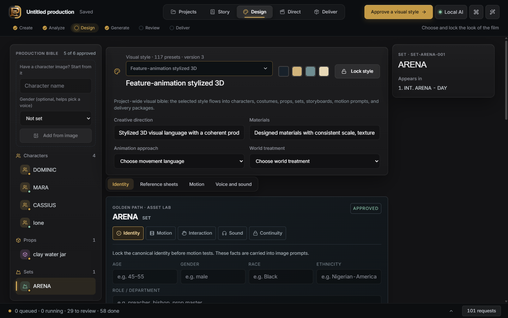
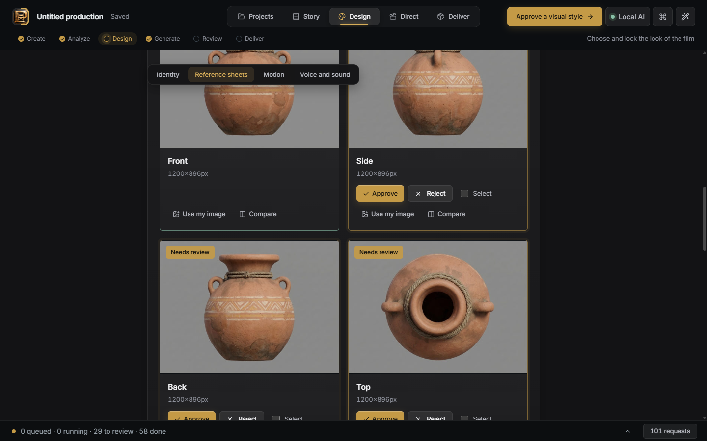
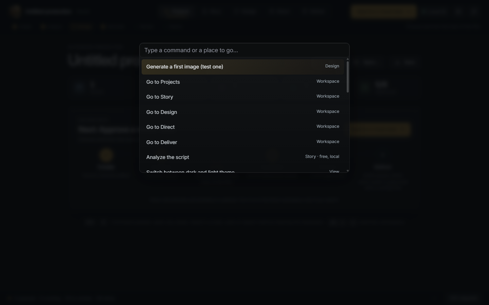
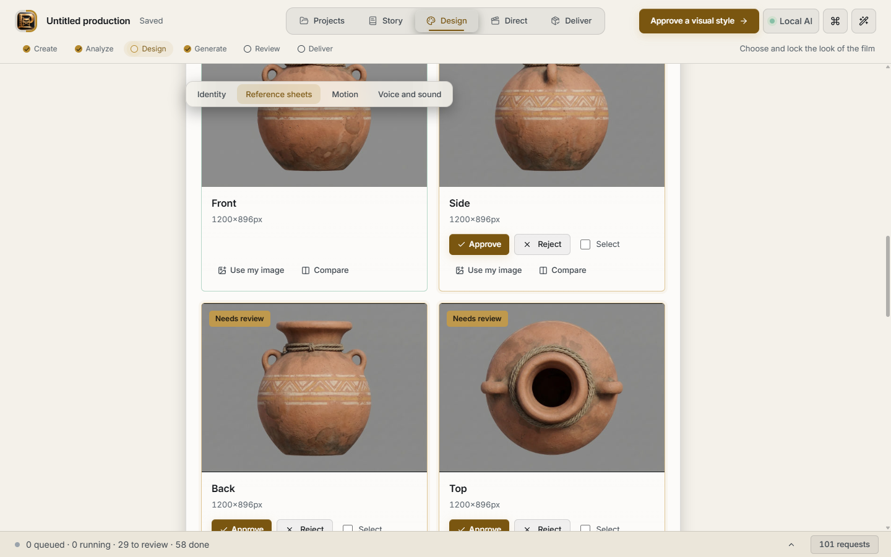

# Design notes (0.39.0)

Production One is a tool people sit in for hours, next to footage and reference art. The interface is therefore quiet: it gets out of the way of the images, and the things that matter (the next step, what needs review, what is running) are the only things that glow.

The look borrows two ideas on purpose. From **Apple**: one typeface used with care, generous but not wasteful space, soft radii, and a focus ring that tells you where you are. From **DaVinci Resolve**: neutral charcoal surfaces so colour in the artwork is judged against grey and not against a tint, thin separators instead of heavy boxes, compact controls, and a page bar (the workspace tabs) that always shows where you are.

## Layout (0.32.0)
One **sidebar** (216 px; 76 px, icons only, below 1280 px wide) replaces the old top bar and step bar. It holds the brand, the project name with its real save state, the workspaces (Projects, Story, Design, Review, Direct, Deliver; Alt+1 to Alt+5 keep their old meaning and Review is Alt+6), the next step as one button with its reason, and Local AI, the command palette and Providers. Everything is in `src/shell-v2.css`, written with `.po-shell` in front so it wins over the older files. Review (`src/views/ReviewView.tsx`, `src/review.css`) is a list, a comparison with the approved reference, and a decision panel. The style gallery (`src/components/StyleGallery.tsx`, `src/gallery.css`) is a dialog rendered in a portal so it centres on screen whatever contains its opener.

**Script and Asset Studio (0.33.0).** Story is a header with a toolbar, then two equal-height panes (the source with its line count; the breakdown with Assets, Questions and Reading tabs). Both panes scroll inside themselves; below 1280 px they stack. Design is an asset header with four tabs (Sheets first); every tab panel stays mounted and is hidden with `hidden`, so a generation in progress or a half-typed field survives a tab switch. Styles are in `src/script.css`. On wide windows `SheetStudio` draws its controls into the inspector through a portal (`controlsSlot`), and keeps them inline when the inspector is hidden (below 1281 px, `useWide` in `DesignView.tsx`). Dialogs (the style gallery, script templates, Add character) are rendered in portals so they centre on screen. The light theme defines `--panel-1`, `--panel-2` and `--line-1`, and text on the dark-gold accent is white there.

**Deliver (0.34.0).** The page runs: summary, package checklist, then three columns (still to do with failed views grouped by cause, hand-off, shot compiler), then the Tasks list. Failed views are grouped by `causeOf` in `src/domain/failureGroups.ts` (an ordered list of message patterns, most specific first, so an insufficient-credits message wins over a 429), and each group offers only fixes that can help. The Tasks list (`src/domain/taskList.ts`) takes each role's brief and evidence from the department plan but decides its group from the project's real state; a task is a pointer to where the work is done, never a job that runs.

## Looks (0.35.0; Cinematic default since 0.36.0)
The app has three looks, chosen in Appearance and stored in `localStorage` (`po.look.v2`, only when a choice is made; until then Cinematic), applied as `data-look` on the root. Studio is the plain tokens and has no rules. Cinematic, the default, also tints the page from the accent, gives panels depth, lays the script out as a centred page and enlarges the cast portraits. `src/looks.css` is imported last (after `polish.css`, which is itself the last layer) so its rules win ties; it sets the colour and font tokens for Cinematic and Futurist in dark and light, plus a few shapes (radius, glow, tracking). Because most screens read the tokens (`--bg`, `--panel-1`, `--panel-2`, `--line-1`, `--text*`, `--gold*`, `--blue`, `--display`, `--ui`, `--radius`), a new look is mostly a new set of values. Cinematic's accent is `--accent-project`, set on the root from the style palette by `accentFromPalette` (`src/domain/appearance.ts`): the most colourful entry, lifted toward white until it has 4.5:1 against the dark surface. Older screens that hard-code colours follow a look only partly; the audit in `scripts/qa/in-page-audit.js` should be run for every look and both themes after any CSS change.

**Cast board (0.37.0).** The Story screen's Assets tab is `src/components/CastBoard.tsx`, with its logic in `src/domain/castBoard.ts` (evidence, scenes, looks, selection). The card row comes first and is pinned (sticky, one scrolling row of 92 px cards) while the selected asset's preview scrolls beneath it. Each kind of asset has a tint (`--tint-character`, `-costume`, `-prop`, `-set`, `-environment`, darker in the light theme) used only as an edge and a border, never as text. The old list is `EditableInventory`, one switch away.

## Typography
- **Fonts by look.** Studio and Futurist headings use Space Grotesk, Cinematic headings use Fraunces, and Futurist body text uses Geist (Inter elsewhere). All are bundled.
- **Two families, each with one job.** Headings, page titles, the wordmark and big numbers use **Space Grotesk** (`@fontsource-variable/space-grotesk`, weights 300 to 700, SIL Open Font Licence). Everything else, including controls, is **Inter**, loaded with its optical-size axis (`@fontsource-variable/inter/opsz.css`). The heading font is the `--display` token, defined in `src/theme.css`, `src/polish.css` and `src/refresh.css` (all three kept identical, because the last one loaded wins); the text font is `--ui`. A test (`src/fonts.test.ts`) checks both are installed, imported at start-up and first in their stacks, and that the security policy allows only the app's own fonts. Large titles use tighter tracking and heavier weight (display cut); small text opens up (text cut). It is bundled, so the app looks the same offline. Courier Prime is kept only for the script editor, where screenplay format needs a monospaced face.
- The stack falls back to the system fonts (`-apple-system`, `SF Pro`, `Segoe UI Variable`), so on a Mac or a modern Windows machine a missing font degrades to the platform's own design face.
- **Scale:** 14 px base, 13 px controls, 12 px field labels and micro-labels (nothing essential under 12 px since 0.32.0). Titles are 1.2 to 2.4 rem, weight 650 to 700, tracking -0.022em to -0.032em.
- **Tabular numbers** on anything that is a reading (counters, costs, the queue, stat tiles), so digits do not jitter as values change, like a timecode.
- **The lowercase l has a tail** (`cv05`). In Inter a capital I and a lowercase l are identical, and this app is full of names ("Ione" must not read "lone").

## Colour
- Since 0.32.0 the dark base is graphite (`--bg` #0d1017), surfaces are `--panel-1` #151a24 and `--panel-2` #1c2330 with `--line-1` #293241 borders, the primary action is champagne (`--gold-2` #d8b779, dark text), and selection and focus are cyan (`--blue` #79d8e8). Tokens live on `:root` in `src/theme.css` (and the light overrides in `src/polish.css`): `--bg`, `--surface`, `--surface-2`, `--stroke`, `--stroke-strong`, `--text`, `--text-2`, `--text-3`, plus the gold accent. Components use the tokens; the light theme only redefines them (`:root[data-theme="light"]`).
- Gold is the single accent and always means "the next thing" or "selected". Status colours (green approved, amber needs review, blue running, red failed) are used only on state.
- Muted text (`--text-3`) is kept at 4.5:1 or better against its surface in both themes; `prefers-contrast: more` raises it further.

## Shape and motion
- Radii: 12 px panels, 8 px controls, 7 px small elements. Shadows are soft and short.
- Motion is short and meaningful (screen entrance, step completion, hover), and all of it respects `prefers-reduced-motion`.
- Sheet thumbnails take the shape of their sheet, so a landscape location is shown as a landscape card.

## Keyboard and focus
Every control is reachable by keyboard. One focus ring everywhere: a 2 px gold ring offset 2 px outside the control. Ctrl+K opens the command palette; Alt+1 to Alt+5 switches workspace; the lightbox, shot editor and sheet cards have their own arrow-key paths (see the user guide).

## Light theme
The light theme is opt-in (palette: *Switch between dark and light theme*). It is warm paper with the same structure. Older stylesheets hard-coded pale greys for the dark theme, so the light theme carries a targeted block that maps every muted and strong text role back to the tokens.

## How the UI is checked
An automated audit (`scripts/qa/in-page-audit.js`, run in the browser pane against the live app or the packaged app's debug port) walks all six workspaces at 1024, 1280, 1440 and 1920 pixels wide, in both themes, and reports: horizontal overflow, clipped text, text under 11.5 px that is not an uppercase micro-label, click targets under 26 px, and text contrast below WCAG AA (4.5:1, or 3:1 for large text). 0.29.0 passes in the dark theme. The light theme's only flagged items are the emotion chips, whose contrast comes from a colour filter the audit cannot measure.

## What is deliberately not done
- No custom window chrome and no Mica or acrylic: the Windows title bar and menus are left to the system.
- No icon-only navigation: workspace tabs always carry their name (the optional tag on Direct hides below 1500 px).
- No second typeface for display. A serif was tried in 0.26 to 0.28 and replaced: a single family reads calmer next to colourful artwork.
