# Production One: from a script to a finished storyboard

This is a walkthrough. It follows one real project, the short film **No VIP in Hell** (7 scenes, 3 sets, 12 props, 2 costumes, 65 storyboard frames), from a pasted script to a saved project. Every picture below was taken from the app with that project open. The full reference of every control is in [USER_GUIDE.md](USER_GUIDE.md).

**The five ideas to hold on to**
1. **The script is the source of truth.** The app reads it and builds a *production bible*: characters, costumes, props and sets.
2. **Every item gets reference pictures first** (a character's face and body, a prop's views, a set's establishing view). You approve them.
3. **Every later picture is made from those approved references**, so a person, a room or an object looks the same from shot to shot.
4. **Nothing is generated or spent until you press a button** that says so.
5. **Save often.** The project is a `.pone` file with a `_files` folder beside it.

---

## 1. The Projects screen: where you are

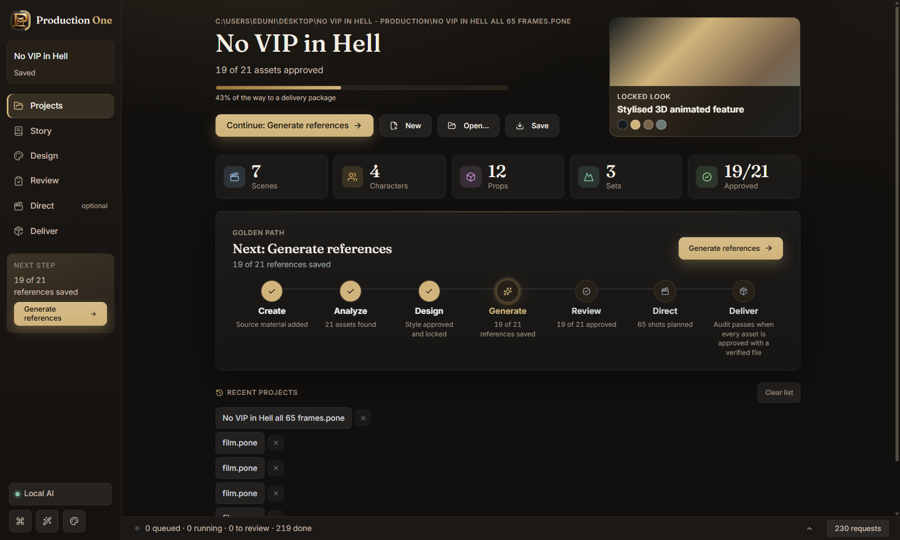

- The big title is the **project name**. The line above it is the file it is saved in.
- **Continue** always names the next useful step. **New**, **Open** and **Save** are here and in the File menu.
- The five tiles count what the script produced: scenes, characters, **props**, **sets**, and how many pictures are approved.
- The **Golden Path** shows the stages: Create, Analyze, Design, Generate, Review, Direct, Deliver. A tick means that stage is done.

### Naming your project
The name appears in the title bar, in the sidebar and on this screen. You can set it two ways:
- **Project > Settings > Title** (also *Ctrl+K*, type "settings").
- **Save As**: if you give the file a new name, the project takes that name (from version 0.46.4). Before that version the title stayed "Untitled production".

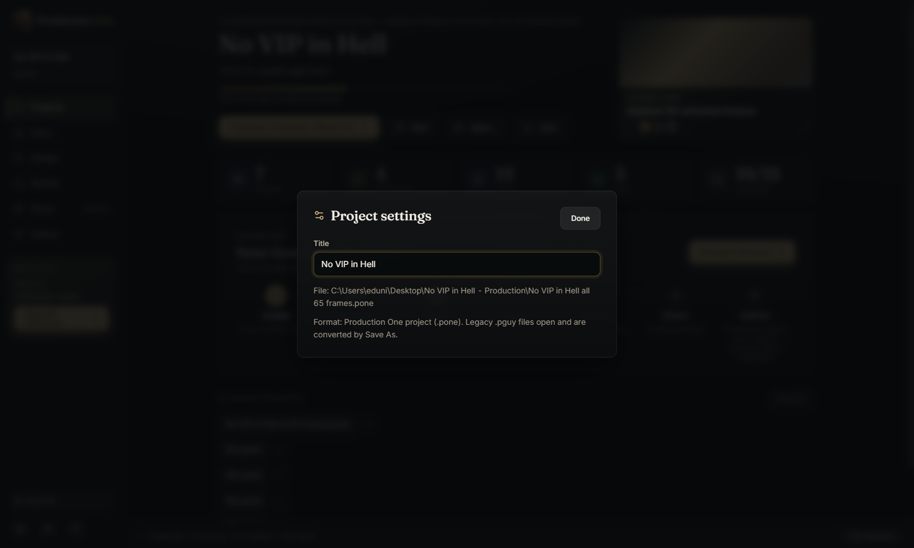

The settings box also shows the file the project is saved in.

---

## 2. Story: give it the script

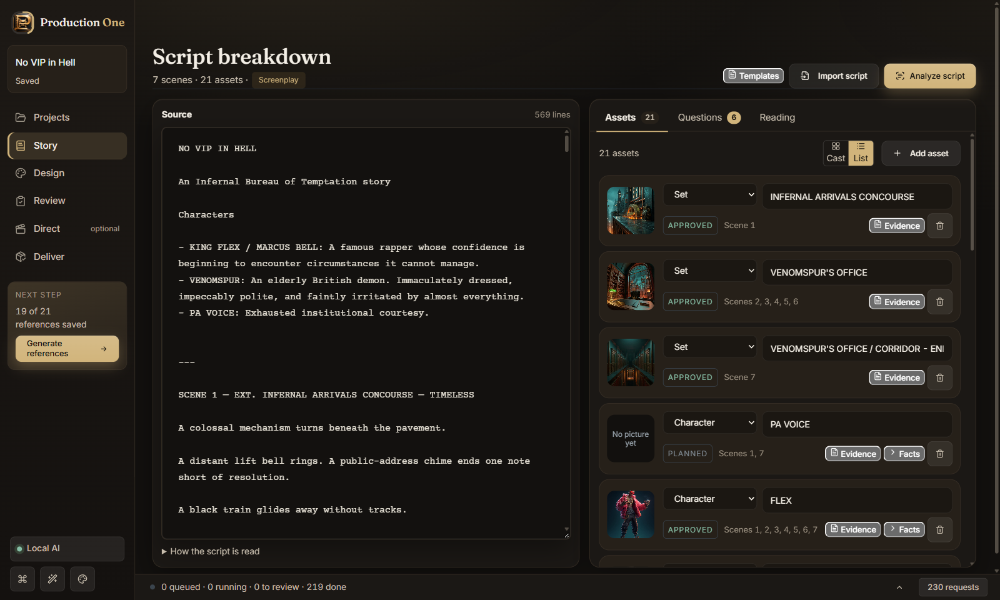

1. Paste the script into **Source**, or press **Import script** (text, Markdown, Fountain, Final Draft, Word, PDF).
2. Press **Analyze script**. The app reads scene headings, who speaks, what people wear, and which objects matter.
3. The right side fills in. It has three tabs: **Assets**, **Questions**, **Reading**.

**Write the script so it reads well.** The reader works best with:
- Scene headings like `SCENE 1 — EXT. INFERNAL ARRIVALS CONCOURSE — TIMELESS`, or `INT. OFFICE - NIGHT`.
- The character's name in capitals above their lines.
- Clothing in the action lines: *Flex wears an oversized coral-red puffer jacket, layered gold chains, black cargo trousers.* (Two or more worn items make a costume.)
- A prop that shows something described right after it: *A photograph slips from the file. A small boy sitting behind a birthday cake.* The picture of the photograph is then that boy.

### Assets: characters, costumes, props, sets

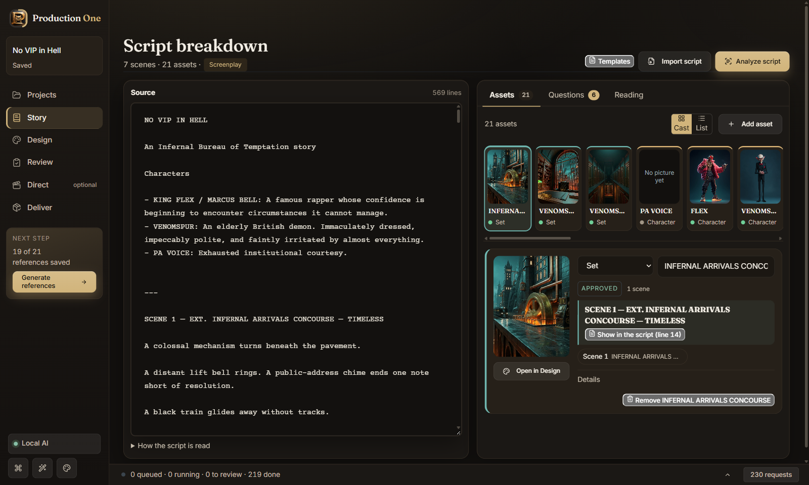

Every character, costume, prop and set has a card. Choose **Cast** (cards) or **List**. Select a card to see the line of the script it came from (**Show in the script**) and the scenes it is in. You can rename it, change its type, **Remove** it or **Add asset** for anything the script missed.

**Where are my sets and props?** They are made by **Analyze script**. They are listed in four places: here, in the Design room's bible (section 3), on the Projects tiles, and on the Deliver checklist. A project that was started only from a character image has none until you analyze a script or add them with **Add to the bible**. The bible always shows all four groups, and says *None yet* for an empty one.

### Questions and Reading
- **Questions** lists what the reader was unsure of (a name that speaks once, a scene with no time of day). Each links to its line in the script.
- **Reading** shows scenes, moods, characters, costumes and props the reader found.

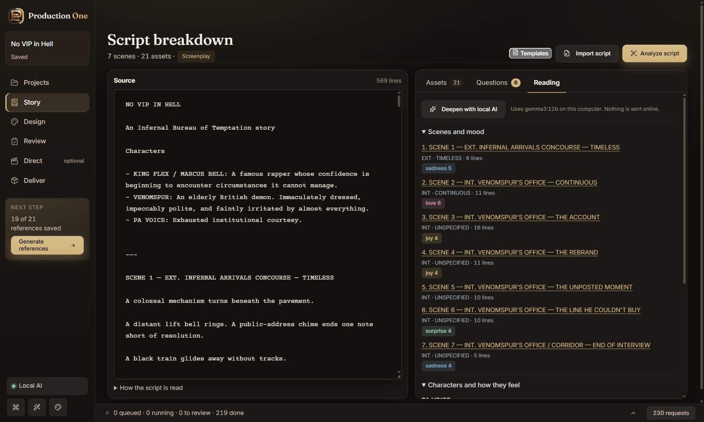

**Keeping a set the same across scenes.** A set is matched by the *text* of the place in the scene heading (the time is not part of it). `INT. VENOMSPUR'S OFFICE - NIGHT` and `INT. VENOMSPUR'S OFFICE - LATER` are one set, and from 0.46.6 `INT. VENOMSPUR'S OFFICE / CORRIDOR` is read as the office too, when the office also appears on its own. If two sets are really one room, select one in the cast board and choose **Merge ... into** the other: its scenes and shots then use the kept set and its approved picture. Frames already made are not changed; regenerate them to use the set picture. Run **Analyze script** again only if you must: if the headings still differ, the second set can come back.

---

## 3. Design: the production bible and reference pictures

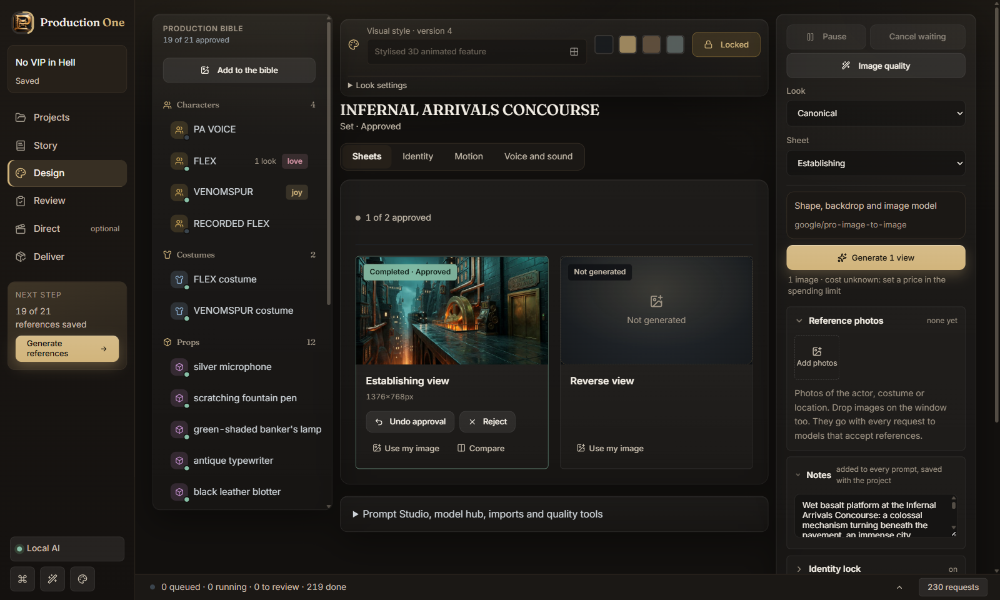

**Left: the production bible.** Characters, Costumes, Props and Sets, each with a count and a status dot (green means an approved reference exists).
**Top: the look of the film.** Pick a style (117 presets; **Browse styles**), then **Lock style** so every picture uses it.
**Centre: the sheets** of the selected item. **Right: the controls** (Look, Sheet, Shape and model, **Generate N views**, reference photos, notes, identity lock).

### The steps for any item
1. Select it in the bible.
2. Choose the **Sheet** (for a set: Establishing, Interior, Exterior, Layout, Lighting).
3. Press **Generate N views**. The line under it says how many images that is. Nothing runs before you press it.
4. Approve what is right (**Approve**) or **Reject**. **Undo approval** is always there.
5. Or press **Use my image** on a view to use a picture you already have (for example from Midjourney). It is kept exactly as it came.

### Characters
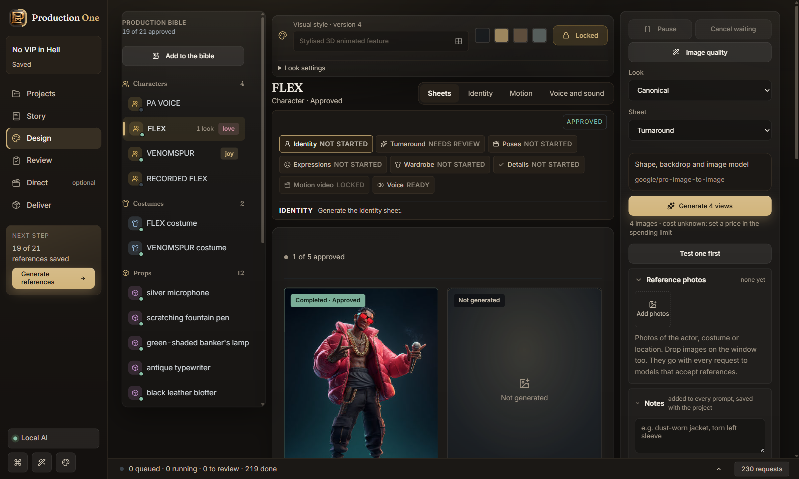

A character has face, turnaround, hands, hair, poses and expressions. The approved front view is the reference for every other view, so the person stays the same (**Identity lock**). The **Identity** tab holds age, gender, role and a **Never** list ("never pale skin") that is written into every prompt.

### Costumes
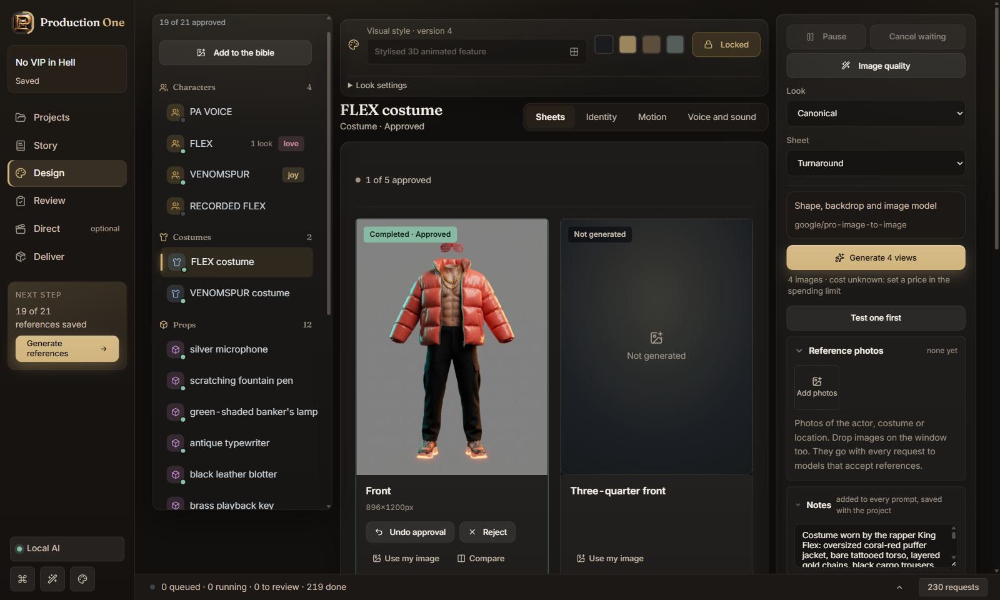

A costume is made from the script's own words about what the person wears. It is sent with the character to every shot, so the jacket does not change.

### Props
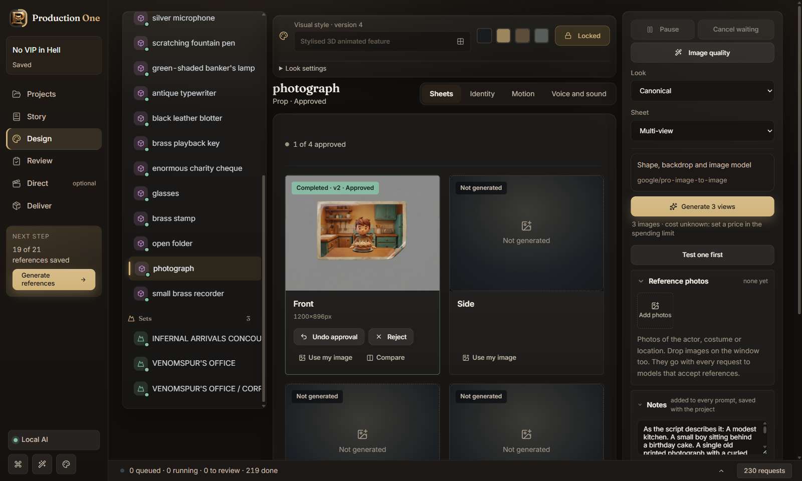

A prop has front, side, back, top and detail views. When the script says what a prop shows, the description goes into its **Notes** ("As the script describes it: ...") and its picture shows exactly that and nothing more. The photograph above shows only the boy at his cake, as the script says.

### Sets
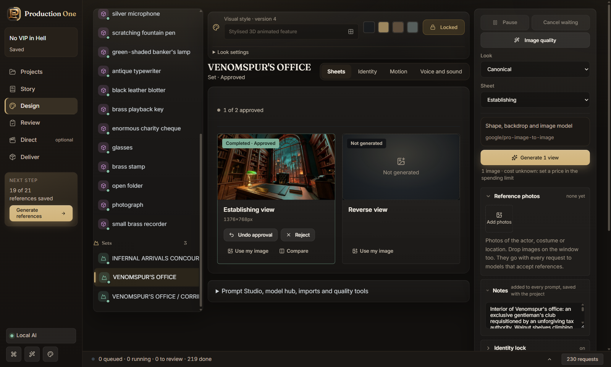

A set gets an establishing view first. Every shot in that location is given this picture as a reference, together with a rule: *keep this exact place, with the same layout, walls, floor, furniture, doors and windows, colours, materials and light sources; show only the part this camera angle sees.* The **Notes** box is added to every prompt for the item, so describe the room there (what is on the left wall, where the window is). This is how sets stay consistent.

**Set consistency in practice**
- Approve one good establishing view of each set *before* you generate frames. A frame with no set picture has nothing to copy from.
- Keep the same place text in every scene heading for the same room, or merge the two sets in Story.
- Put fixed details in the set's Notes ("the desk is under the window, the lamp is green").
- If a frame drifts, press **Regenerate** on that frame. The prompt and the set picture stay the same; a new take is made.
- A model can still ignore the rule. The rule makes drift less likely; it does not forbid it. Check frames next to each other.

---

## 4. Review: decide what is waiting

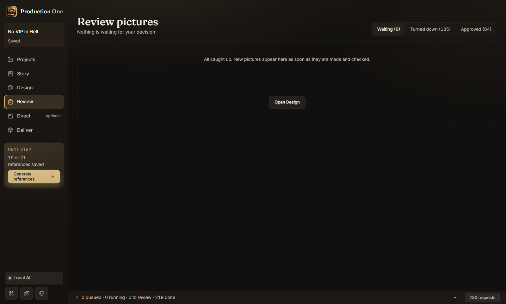

Pictures that are made and not yet judged appear under **Waiting**, large, next to the approved reference they must match. **Approve**, **Request changes** or **Reject**. **Turned down** and **Approved** list the rest, and any decision can be changed. In this picture nothing is waiting, so the room says so.

---

## 5. Direct: the storyboard

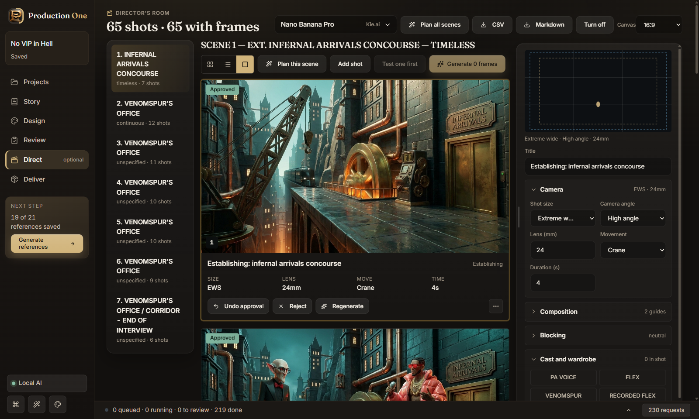

1. Turn on the **Director's room** and press **Plan all scenes**. The app plans an establishing shot per new location, a master shot, a close-up for each line of dialogue, and an insert shot for a prop that returns.
2. Each shot card shows the frame, size, lens, movement and the line spoken.
3. **Generate frame** makes the picture. It is sent the approved pictures of the people in the shot, their costumes, the props near that moment, and the set.
4. **Regenerate**, **Approve**, **Reject** and the **...** menu (your own image, move, duplicate, delete) are on each card.

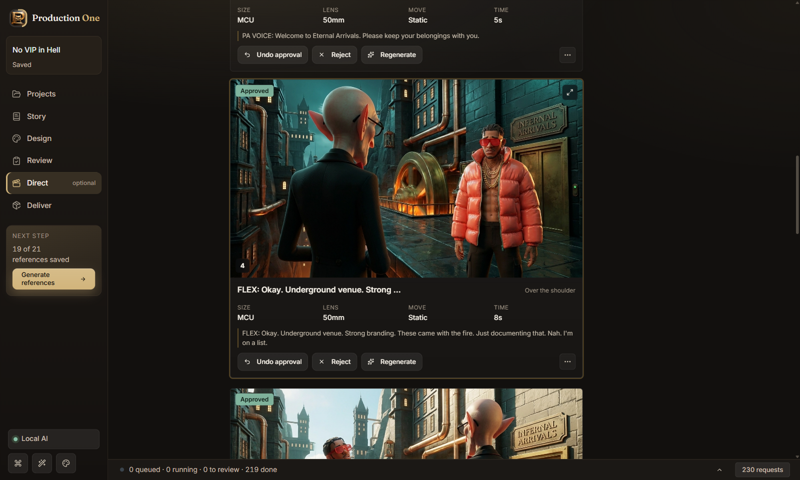

**Who appears in a frame.** A shot with people in it says that *only those people* appear: no crowd, creatures or bystanders. An establishing shot may show a busy place. What a described prop shows is exactly its description.

**If you use Analyze script again** after you have planned shots, the shots stay in their scenes. Planning a scene again keeps shots that already have a frame and does not draw them twice.

---

## 6. Deliver: checklist and hand-off

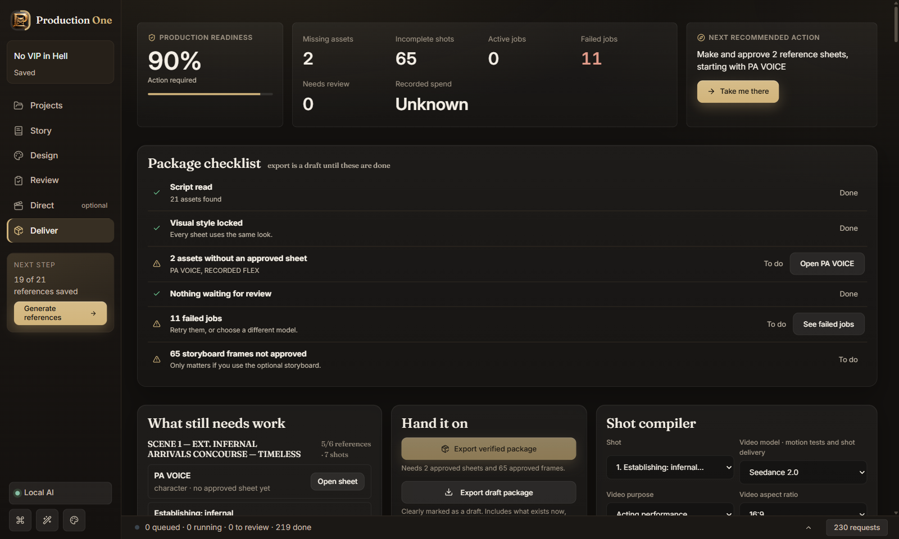

- **Package checklist**: script read, style locked, every asset has an approved sheet, nothing waiting for review, failed jobs, storyboard frames approved. Each open line has a button to where it is fixed.
- **What still needs work**: items by scene.
- **Hand it on**: *Export verified package* needs every sheet and frame approved. *Export draft package* is always there and is marked as a draft.
- **Shot compiler**: builds the prompt for a video model (Seedance, Kling, Veo and others) from a shot's data.

---

## 7. Saving, moving and backups

- **Save** (*Ctrl+S*) writes `name.pone` and a folder `name_files` beside it with every picture, sound and clip. **Move both together.**
- **Save As** to make a copy under a new name; the project takes that name.
- Starting a new project or opening another one first copies unsaved work to `Documents\Production One\Backups` (newest 30 kept).
- The title bar shows a dot before the name when there are unsaved changes.

---

## 8. Money and keys

- Cloud pictures and video are billed by the provider (Google, Kie.ai, ElevenLabs and others). The app does not know prices. In the queue bar at the bottom you can type your own price per request and set a cap; the counter there counts requests.
- A button that will spend says so, and a batch shows its list first.
- Keys are stored in the Windows credential store, one per provider (**Providers**, bottom-left). They are never written into the project.
- A provider can run out of credit or hit a limit. Frames then fail; the Deliver room counts them under **failed jobs**. The app does not yet show the reason on the frame itself; the provider's dashboard does.
- To save money, use a lower-cost model for first tests and keep the premium ones for final frames. Video models are grouped as *Lower cost*, *Premium* and *Other*.

---

## 9. Quick answers

| I want to... | Do this |
|---|---|
| See sets and props | Analyze a script in Story; then look in Design's bible, or the Projects tiles |
| Rename the project | Project > Settings, or Save As with a new file name |
| Use my own picture for a character, set or prop | Design > **Add to the bible** > **Add from image**, or **Use my image** on a view |
| Make a room look the same in every shot | Approve its establishing view first; same place text in every heading; describe it in Notes |
| Stop extra people in a frame | They are asked not to appear. If one does, **Regenerate** the frame |
| Find any command | *Ctrl+K* |
| Change the look of the app | Palette icon at the bottom of the sidebar |

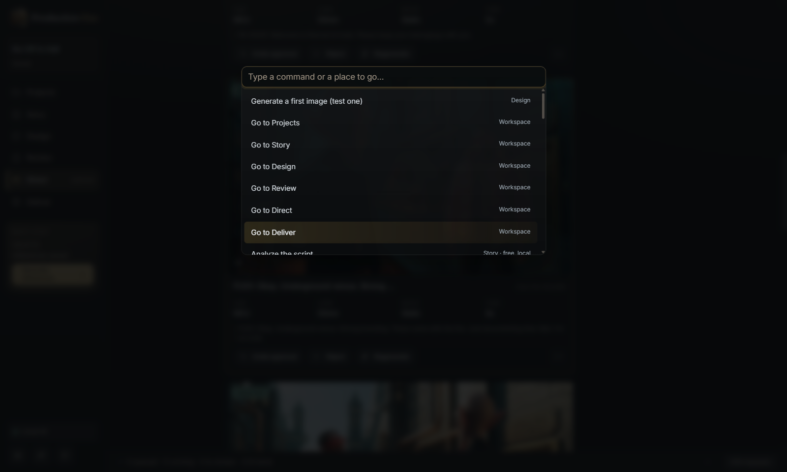

## 10. What this version does not do yet
- A merged set can come back if you run Analyze script again while the headings still differ.
- The reason a frame failed is not shown on the frame.
- Props are recognised from a list of object nouns, so an unusual prop may be missed; add it with **Add asset**.
- Installers are not code-signed, so Windows SmartScreen may warn.
