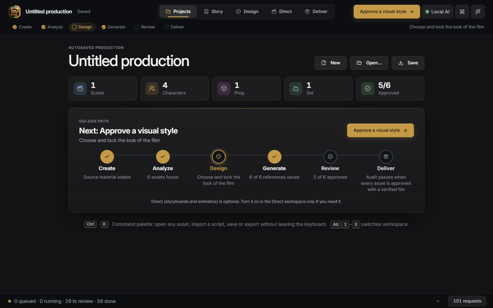
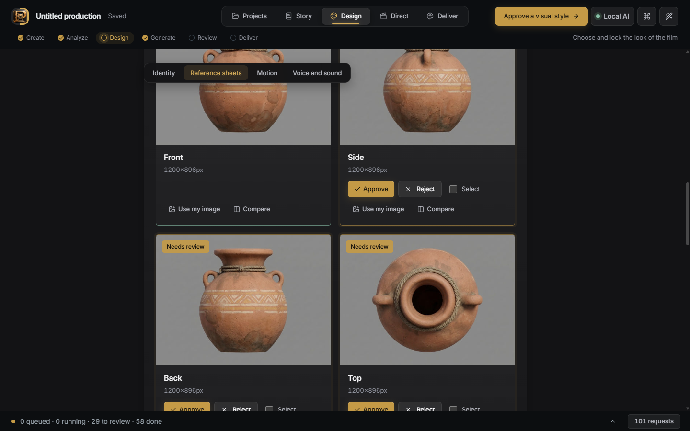
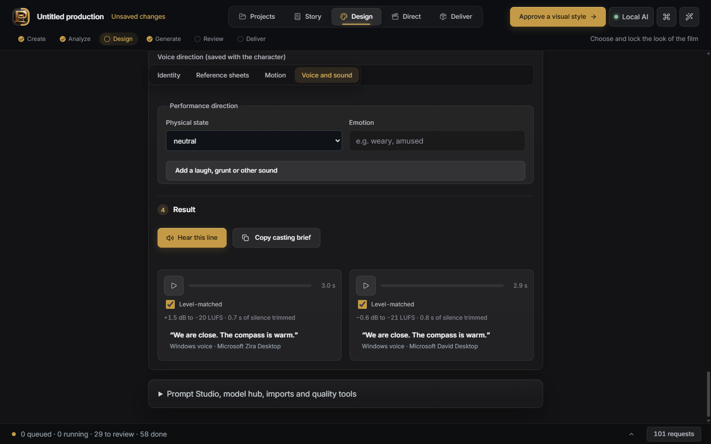
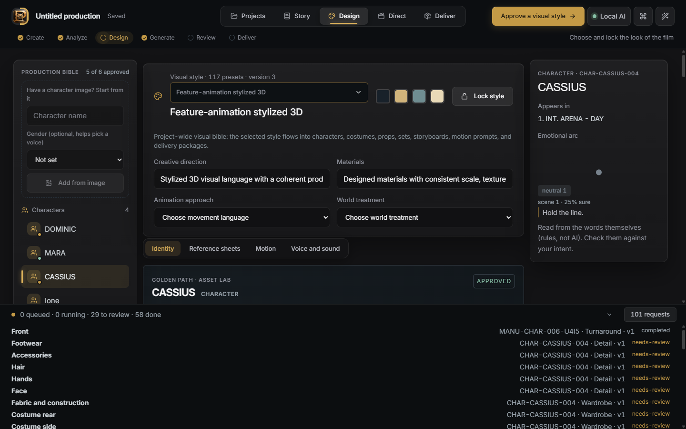

# Production One user guide

Follow the **Golden Path**; the sidebar shows your next step: Create, Analyze, Design, Generate, Review, Deliver (Direct is optional). The gold button in the sidebar always names the next useful step. **Ctrl+K** opens the command palette for any action, and **Alt+1 to Alt+6** switches workspace (Projects, Story, Design, Direct, Deliver, Review).

The **sidebar** on the left holds the project name and its save state, the workspaces, the next step as one gold button, Local AI, the command palette and Providers. Below 1280 px wide it shrinks to icons. *The screenshots in this guide were taken before 0.32.0 and show the older top bar; the same controls are now in the sidebar.*

## Projects, files and backups
- **New / Open / Save** are in the File menu and on Projects. Projects are `.pone` files. Old `.pguy` projects open and are saved as a new `.pone`, leaving the original untouched.
- **Recent projects** on the Projects screen show file names only. Press **×** on an entry to remove it from the list, or **Clear list** to remove them all. This never deletes a project file.
- Double-click a `.pone` or `.pguy` in Explorer to open it. If Production One is already running the project opens in that window.
- The title bar shows *Unsaved changes*, *Autosaved* or *Saved*. Closing with unsaved changes asks first.
- **Nothing is lost when you start a new production or open another one.** If the production on screen has work in it and is not safely in a saved file, the app first copies it to `Documents\Production One\Backups` (newest 30 kept) and tells you where the copy is. If the copy cannot be made, nothing is replaced. Open a backup with **Open** like any project.

## Story

The Story screen (**Script breakdown**) has the script on the left and the breakdown on the right. The toolbar has **Import script** (txt, md, Fountain, Final Draft, Word, PDF; Word and PDF come from the desktop app, and scanned PDFs need OCR first), **Analyze script**, and **Templates**.

The breakdown has three tabs:
- **Assets**: every character, costume, prop and set the script needs, each with its type, an editable name, a picture once one is approved, its status, the scenes it is in, an **Evidence** button that jumps the script to where it comes from, and (for characters) a **Facts** toggle for age, gender, race, ethnicity and role. Add or remove assets here.
- **Questions**: what the reading is unsure about (a name that speaks only once, a scene with no time of day), kept apart from the findings the script clearly supports. Each line links to its script line. The number on the tab is how many need your check.
- **Reading**: scenes and mood, characters and how they feel, ages, costumes and conditions, and props. **Deepen with local AI** (optional) asks a local model for beats and keeps only those whose quoted evidence is in the script.

**Templates** are shown only when the script is empty, or on request in a dialog from the toolbar. They are a starting point: imported source text is preserved, and nothing is replaced until you choose **Use as starting point**.

## Design (Asset Studio)
The left side lists every asset (add a character from an image with the button at the top). The top strip shows the film's **look**: its name, a **Browse styles** button, the palette and **Lock style**; **Look settings** folds away the name, creative direction, materials, animation approach and world treatment. Below it, the chosen asset has four tabs: **Sheets** (the default: the pictures), **Identity**, **Motion**, and **Voice and sound**. Switching tabs never loses what you were doing. On a wide window (1281 px and up) the sheet's controls (Pause, Image quality, Look, Sheet, shape, backdrop and model, **Generate**, reference photos, notes, identity lock) are in the panel on the right, so the pictures have the whole centre; on a narrower window they sit above the pictures, with shape, backdrop and model folded under one line that names the model.

The **production bible** (left) lists every character, prop and set. The **visual style** (117 presets) flows into every prompt; **Lock style** freezes it.

### Starting from an image you already have (for example from Midjourney)
In the bible press **Add character from image**, type a name in the dialog, optionally choose a gender (it helps pick a matching voice and is never guessed), and press **Add from image**. Choose the image: it becomes the approved front view, the identity lock turns on, and every other sheet is built from it. No script is needed. A character can also be started from a script and have its front view replaced with **Use my image**.

### Identity fields
On a character's **Identity** tab: age, gender, race, ethnicity and role go into every image and video prompt. Two more fields are yours to use:
- **Personality** (timid, cool, bratty, aggressive, warm) shapes the delivery tags of the emotional-range casting line and adds one line about carriage to that character's motion prompts. It never changes how the character looks.
- **Never** is a list of drifts to prevent, in your own words ("never pale porcelain skin, never a teeth-showing smile"). It is written into every prompt as *Must never drift: ...*.

### Reference sheets

1. Pick an asset in the bible.
2. Choose **Look** (story variant), **Sheet**, **Shape**, **Backdrop** and **Model**.
3. **Generate N views**, or **Test one first**.
4. Approve what you like. The approved front view is sent as the reference for the other views (**Identity lock**). A front-type view on another sheet (for example the Wardrobe sheet's costume front) also uses the character's approved front, so it cannot invent a different person.
5. **Large previews** and **Compare** (pick two views) help judge consistency. Click an image to open it full size (wheel zoom, drag, arrows, A approve, R reject).
6. **Use my image** on any view, or **Add photos** of the actor, costume or location (also by dragging files onto the window). Your own images are stored exactly as they came.

| Asset | Sheets | Default shape |
|---|---|---|
| Character | Identity, Turnaround (front, three-quarter front, side, three-quarter rear, rear), Expressions (from the story's feelings, or eight standard ones), Poses (eight), Wardrobe, Detail | Portrait 3:4; close-ups square |
| Prop | Multi-view (front, side, back, top), Functional (working state, scale), Detail (material, damage) | Landscape 4:3 |
| Set | Establishing, Interior, Exterior, Layout (floor plan), Lighting | Wide 16:9; the floor plan 4:3 |

**Shape** (portrait 3:4, tall 9:16, square 1:1, landscape 4:3, wide 16:9) changes the shape of new images on one sheet; images already made keep theirs. **Backdrop** chooses one flat background for every new image on the sheet (flat grey, flat white, or match the reference), so the views agree with each other. Both are saved with the project.

### Export a sheet as one image
**Export sheet as one image** puts the views of a sheet into one labelled PNG. **Export every sheet as one image** does the same for all of an asset's sheets (up to 40 views), which is the way to export a location whose sheets hold one view each. Files go to `Documents\Production One\Sheets`.

### Choosing a look
On the Design screen press **Browse styles**. The gallery has a picture for every one of the 117 styles, all showing the same scene so you compare styles, not subjects. Search (every word must match), filter by family, star favourites (kept on this computer), and click a style to see its description, palette, materials, rendering and lighting. **Use this style** applies it without locking it; lock it on the Design screen when you are happy. The gallery cannot be opened while the style is locked.

### Image quality (CleanRender)
Open **Image quality** in the sheet header. It measures the image and suggests fixes in plain language, for example "the mid-tones lean strongly yellow". **Try this** sets sliders; the split view shows original and corrected live. **Save corrected revision** writes a new file and a new revision; the original is never changed. **Apply to all** uses the same settings on every image of the sheet. It cannot fix faces, hands, likeness or plastic-looking skin; for those it says to regenerate, use a reference photo, or retouch.

### Motion and voice
On an asset's **Motion** tab, choose a clip (turntable, idle, walk, run, speaks to camera, emotion beat, your own description), a video model and a length, then **Generate motion demo**. The turntable asks for one full 360 degree turn from the approved front view.

On the **Voice and sound** tab, pick an engine (free Windows voices, ElevenLabs, VoiceKiller, or a local speech server), a voice, and a line. Each character gets its own suggested Windows voice from its stated gender and age.

**Design a voice.** Under the engine, **Fill from the script** writes a voice description from the character's confirmed age, gender, role, personality and sound direction and from their own dialogue, and shows what it was built from; if the script says too little it says what is missing and writes nothing. **Ask the AI helper** has your local model (Ollama or LM Studio) write one from a rough idea; only confirmed fields and the character's lines are sent, and nothing leaves your computer. The description feeds ElevenLabs Voice Design (three previews, then keep one; keeping uses a custom-voice slot) and the Qwen TTS voice field. Chatterbox clones from a recording and cannot design from words, so it shows a note.

**Music with Suno.** Under **Make music with Suno** you can make a theme for the character or the score for a scene they are in. Write the style from the script (stated personality and role, and the scene's heading: where and when), with the AI helper, or by hand; choose the model (V6 Mini, V6, V6 Wild), the length and instrumental or your own lyrics. Each request makes two tracks and spends Kie.ai credits. Suno is reached through Kie.ai, a third-party service, so your text goes to Kie.ai when you press **Make music**; check Kie's and Suno's terms before commercial use. Tracks are saved with the audio clips.

Each clip plays **level-matched** (to -20 LUFS, never boosted past 12 dB or into clipping) with the silence at its two ends trimmed, so voices are compared fairly; the line under the player says what was done. Untick **Level-matched** to hear the original as recorded. Your saved files are never changed.

**Casting line** gives every candidate voice the same words so you compare voices, not wording: a pangram (English; Spanish, French and German letter pangrams), draft lines for Nigerian Pidgin, Yoruba, Igbo and Hausa, or an emotional-range line shaped by the character's personality. The Spanish, French, German and Nigerian-language lines are labelled for a native speaker to check, and the Nigerian-language lines are drafts that were not written by a native speaker. Delivery tags such as `[whispers]` are added only on an ElevenLabs model that reads them (Eleven v3 or later); other engines get plain text.

## The queue

Generation runs in the queue at the bottom, two at a time. **Pause** lets running images finish and holds the rest. Views that match a front view wait until you approve it; the bar says how many are waiting and offers **Open sheets**. If the app closes in the middle of generation, the images that were in flight come back marked *failed, may already be billed* so you can decide whether to retry; waiting images are kept and the queue starts paused.

## Review
**Review** (sidebar, or Alt+6) shows each picture waiting for your decision, large, next to the approved reference it has to match, with a badge in the sidebar for how many wait. Technical checks are listed apart from your decision. **Approve** it; **Request changes** (turns it down and opens its sheet; nothing is generated); or **Reject** (keeps the file; find it again under *Turned down*). Generation details and the prompt are one click away.

## Direct (optional)

Turn on the Director's room, then **Plan all scenes**. Select a shot to edit it in the sections on the right (drag the edge to resize). **Generate frame** is the main action on a card; the **...** menu has your own image, move, duplicate and delete. Arrow keys move between shots; drag a card to reorder inside its scene. Grid, list and large layouts are in the toolbar. Continuity notes appear under the cards. The animatic plays the frames with dialogue and a temp track. Export the shot list as CSV or Markdown.

## Deliver

The **package checklist** comes first: script read, style locked, every asset has an approved sheet, nothing waiting for review, failed jobs. Each open line has a button to where it is fixed, and an export is a draft until the list is done. Below it are the hand-off options (verified or draft package, then the optional shot compiler, collapsed when no shots are planned) and the **Tasks** list.

**Failed views by cause.** Under *What still needs work*, views that failed for the same reason are one group: how many, which models, what happened, and only the fixes that can help (**Refresh models**, **Use {your chosen model} for these**, **Choose a model**, **Provider Settings**, **Retry all**). The message for each view is under **Details**, with its own Retry. Retrying sends the views to the provider again and may use credits.

**Tasks** lists the work by role, grouped as Needs approval, Ready or running, Blocked and Complete. Each line says what it is about, why it is where it is, and has a button to the place the work is done; the arrow opens the brief, the evidence it was based on, and what it waits on. The tasks do not run anything: they tell you where to go. The top row shows readiness, what is missing, active and failed jobs and the next action. *What still needs work* lists items by scene with buttons that take you to them. The *Shot compiler* builds the prompt for Seedance, Kling or Veo from the shot's data; you can edit it and copy it. *Export verified package* is available only when every sheet and frame is approved; *draft package* is always available and is marked as a draft.

## Appearance
The palette icon at the bottom of the sidebar opens **Appearance**. Pick a look and it applies at once; each card previews its own colours and heading font.
- **Studio**: calm graphite and champagne (the default).
- **Cinematic**: warm surfaces and serif page titles. Its accent comes from your visual style's palette, so changing the style changes the accent.
- **Futurist**: near-black blue, a cyan accent with a soft glow, tighter corners.
The same dialog switches dark and light. Your choice is remembered on this computer and never changes what anything does. Ctrl+K also has "Appearance: Studio / Cinematic / Futurist".

## Command palette, shortcuts and themes

**Ctrl+K** opens the palette. The dark theme is the default; **Switch between dark and light theme** is in the palette and works on every screen.

## Providers and local AI
**Providers** stores a key per provider in the Windows credential store. **Local AI** shows Ollama, LM Studio and ComfyUI, what your GPU can run, and can install ComfyUI and download SDXL and Wan 2.2 5B (large downloads, resumable). Local models appear in the same model picker.

## Cost
Cloud models bill at the provider. The small counter in the queue dock counts requests; switch on a cap there with your own price per request if you want one. The app never states a price of its own.

## Troubleshooting
| Symptom | Fix |
|---|---|
| "401" or "invalid key" | The provider rejected the key: re-enter it in Providers (check for extra characters or capitals). |
| A view stays *Queued* | It waits for the approved front view (the queue bar says so), or the queue is paused, or a spending cap is on. |
| "Kie has no model page called ..." | Kie sometimes refuses a model it served minutes ago. The app retries it after a pause; if it keeps failing, press **Refresh models**. |
| Nothing generates in the browser preview | Generation runs in the Windows app. |
| Word/PDF import says no text | The PDF is a scan; run OCR first or paste the text. |
| ComfyUI "not running" | Open Local AI and press Start. |
| I opened a project and lost the one I had | Look in `Documents\Production One\Backups`; the app saved a copy first. |
