# Production One user guide

**New here? Read the illustrated walkthrough first: [GETTING_STARTED.md](GETTING_STARTED.md)** (script to finished storyboard, with a picture of every room). This page is the reference for every control.

Follow the **Golden Path**; the sidebar shows your next step: Create, Analyze, Design, Generate, Review, Deliver (Direct is optional). The gold button in the sidebar always names the next useful step. **Ctrl+K** opens the command palette for any action, and **Alt+1 to Alt+6** switches workspace (Projects, Story, Design, Direct, Deliver, Review).

The **sidebar** on the left holds the project name and its save state, the workspaces, the next step as one gold button, Local AI, the command palette and Providers. Below 1280 px wide it shrinks to icons. *The screenshots of the workspaces, the palette and the light theme were retaken for 0.38.0. The voice picture was retaken for 0.39.0. The sheet, audition and queue pictures are older and show the previous top bar (they need generated pictures and a busy queue, which the art-free demo project does not have); the same controls are now in the sidebar.*

The top of Projects shows where the production stands: a progress bar, one big **Continue** button for the next step, and the look of the film as a picture.

## Projects, files and backups
- **New / Open / Save** are in the File menu and on Projects. Projects are `.pone` files. Old `.pguy` projects open and are saved as a new `.pone`, leaving the original untouched.
- **Recent projects** on the Projects screen show file names only. Press **×** on an entry to remove it from the list, or **Clear list** to remove them all. This never deletes a project file.
- Double-click a `.pone` or `.pguy` in Explorer to open it. If Production One is already running the project opens in that window.
- The title bar shows *Unsaved changes*, *Autosaved* or *Saved*. Closing with unsaved changes asks first.
- **Nothing is lost when you start a new production or open another one.** If the production on screen has work in it and is not safely in a saved file, the app first copies it to `Documents\Production One\Backups` (newest 30 kept) and tells you where the copy is. If the copy cannot be made, nothing is replaced. Open a backup with **Open** like any project.

## Story
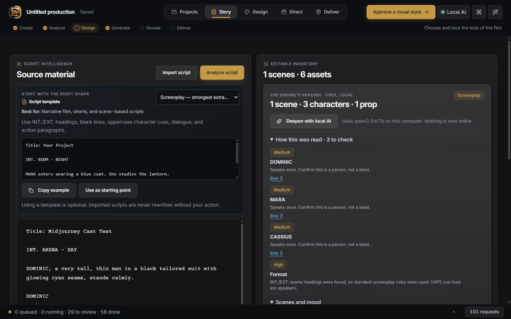

The Story screen (**Script breakdown**) has the script on the left and the breakdown on the right. The toolbar has **Import script** (txt, md, Fountain, Final Draft, Word, PDF; Word and PDF come from the desktop app, and scanned PDFs need OCR first), **Analyze script**, and **Templates**.

The breakdown has three tabs:
- **Assets**: the **cast board**. A card for every character, costume, prop and set the script needs (its approved picture, name, type and status). Select one to see a large picture beside what the script says about it: the line that introduces a character, the line a prop was found on, or a set's first scene, each with **Show in the script**, and the scenes it is in as chips that jump to them. Under *Looks and facts* are the ages and costumes the script gives a character and the facts that go into image prompts; the name, type and facts are editable, and **Remove** removes the asset. **Make its sheets** (or **Open in Design**) takes you to the asset's sheets. Arrow keys move between cards. **List** switches to the compact list for projects with many assets (the choice is remembered). Add assets here too.
- **Questions**: what the reading is unsure about (a name that speaks only once, a scene with no time of day), kept apart from the findings the script clearly supports. Each line links to its script line. The number on the tab is how many need your check.
- **Reading**: scenes and mood, characters and how they feel, ages, costumes and conditions, and props. **Deepen with local AI** (optional) asks a local model for beats and keeps only those whose quoted evidence is in the script.

**Templates** are shown only when the script is empty, or on request in a dialog from the toolbar. They are a starting point: imported source text is preserved, and nothing is replaced until you choose **Use as starting point**.

## Design (Asset Studio)
The left side lists every asset (add a character from an image with the button at the top). The top strip shows the film's **look**: its name, a **Browse styles** button, the palette and **Lock style**; **Look settings** folds away the name, creative direction, materials, animation approach and world treatment. Below it, the chosen asset has four tabs: **Sheets** (the default: the pictures), **Identity**, **Motion**, and **Voice and sound**. Switching tabs never loses what you were doing. On a wide window (1281 px and up) the sheet's controls (Pause, Image quality, Look, Sheet, shape, backdrop and model, **Generate**, reference photos, notes, identity lock) are in the panel on the right, so the pictures have the whole centre; on a narrower window they sit above the pictures, with shape, backdrop and model folded under one line that names the model.

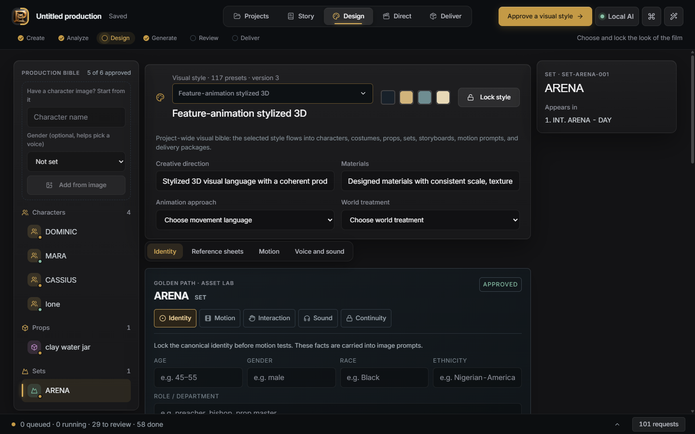

The **production bible** (left) lists every character, prop and set. The **visual style** (117 presets) flows into every prompt; **Lock style** freezes it.

### Starting from an image you already have (for example from Midjourney)
In the bible press **Add to the bible**, choose what it is (**Character, Costume, Prop or Set or location**), type a name, and (for a character) optionally choose a gender: it helps pick a matching voice and is never guessed. Then press **Add from image** and choose the image: it becomes the approved reference (a character's front view, a costume's front, a prop's front, a set's establishing view), the identity lock turns on, and every other sheet is built from it. **Add without image** plans its sheets and you generate the first picture yourself. No script is needed, and the bible always lists Characters, Costumes, Props and Sets, saying *None yet* for an empty group: sets and props normally come from analysing a script in Story, so a project started from an image has none until you add them or analyse a script. A character can also be started from a script and have its front view replaced with **Use my image**.

### Identity fields
On a character's **Identity** tab: age, gender, race, ethnicity and role go into every image and video prompt. Two more fields are yours to use:
- **Personality** (timid, cool, bratty, aggressive, warm) shapes the delivery tags of the emotional-range casting line and adds one line about carriage to that character's motion prompts. It never changes how the character looks.
- **Never** is a list of drifts to prevent, in your own words ("never pale porcelain skin, never a teeth-showing smile"). It is written into every prompt as *Must never drift: ...*.

### Reference sheets
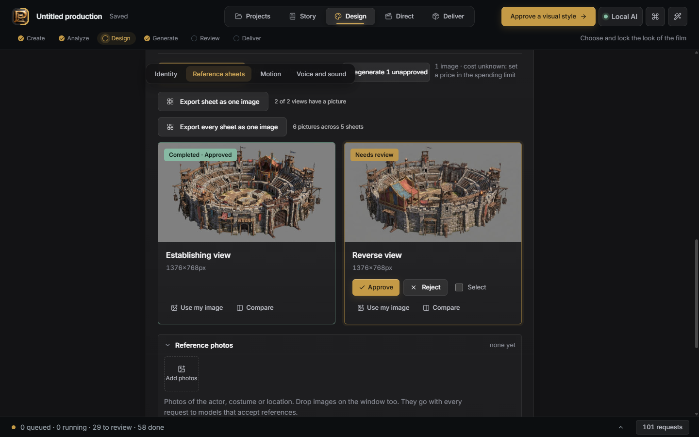

1. Pick an asset in the bible.
2. Choose **Look** (story variant), **Sheet**, **Shape**, **Backdrop** and **Model**.
3. **Generate N views**, or **Test one first**.
4. Approve what you like. The approved front view is sent as the reference for the other views (**Identity lock**). A front-type view on another sheet (for example the Wardrobe sheet's costume front) also uses the character's approved front, so it cannot invent a different person.
5. **Large previews** and **Compare** (pick two views) help judge consistency. Click an image to open it full size (wheel zoom, drag, arrows, A approve, R reject).
6. **Use my image** on any view, or **Add photos** of the actor, costume or location (also by dragging files onto the window). Your own images are stored exactly as they came.

**Making a failed or waiting view with another engine.** On a view that failed or is queued, **Make this view with** is a drop-down. The newest model of each family comes first (Nano Banana 2.1, Nano Banana Pro, Seedream 5.5, GPT Image 2.6, Ideogram Character, Wan 2.7 Image Pro, MiniMax H3, and a model on this computer), then every other image model the catalog lists (press *Refresh models* in the model picker to read Kie.ai's current list; no key needed). The engine the view used before is marked *(used before)* and can be chosen again. An engine you have no key for is greyed out and says which key it needs; one that cannot take reference images says *no identity lock*. Choosing does nothing by itself: press **Use ...**, and the spending limit still applies.

| Asset | Sheets | Default shape |
|---|---|---|
| Character | Identity, Turnaround (front, three-quarter front, side, three-quarter rear, rear), Expressions (from the story's feelings, or eight standard ones), Poses (eight), Wardrobe, Detail | Portrait 3:4; close-ups square |
| Prop | Multi-view (front, side, back, top), Functional (working state, scale), Detail (material, damage) | Landscape 4:3 |
| Set | Establishing, Interior, Exterior, Layout (floor plan), Lighting | Wide 16:9; the floor plan 4:3 |

**Shape** (portrait 3:4, tall 9:16, square 1:1, landscape 4:3, wide 16:9) changes the shape of new images on one sheet; images already made keep theirs. **Backdrop** chooses one flat background for every new image on the sheet (flat grey, flat white, or match the reference), so the views agree with each other. Both are saved with the project.

### Export a sheet as one image
**Export sheet as one image** puts the views of a sheet into one labelled PNG. **Export every sheet as one image** does the same for all of an asset's sheets (up to 40 views), which is the way to export a location whose sheets hold one view each. Files go to `Documents\Production One\Sheets`.

### Choosing a look
On the Design screen press **Browse styles**. The gallery has a picture for every one of the 117 styles, all showing the same scene so you compare styles, not subjects. Search (every word must match), filter by family, star favourites (kept on this computer), and click a style to see its description, palette, materials, rendering and lighting. **Use this style** applies it without locking it; lock it on the Design screen when you are happy. The gallery cannot be opened while the style is locked.

### Image quality (CleanRender): editing that never touches the original
Open **Image quality** in the sheet header, or in the Director's room above the cards (it works on that scene's storyboard frames). It measures the image and suggests fixes in plain language, for example "the mid-tones lean strongly yellow". **Try this** sets sliders; the split view shows original and corrected live. **Save corrected revision** writes a new file and a new revision; the original is never changed. **Apply to all** uses the same settings on every image of the sheet. 
The controls: **Brightness** and **Contrast** (about one stop each way), **Temperature**, **Tint**, **Colour strength** (all the way down is black and white), **Highlight recovery**, **Bloom reduction**, **Noise reduction**, **Texture kept**, **Sharpness**, and **Overall strength**. **Enlarge** makes the picture 2x or 4x bigger with a smooth filter (never past 8192 pixels on the long edge). It does **not** add detail and it is not an AI upscaler; for real detail regenerate at a higher quality or use a dedicated upscaler.

Every save writes a new file (`name_clean_01.png`) and a new revision. The original stays, and you can go back to it. It cannot fix faces, hands, likeness or plastic-looking skin; for those it says to regenerate, use a reference photo, or retouch.

### Bringing in images from Midjourney (or anywhere)
Midjourney has no public connection, so the way in is your files. In **Add to the bible** choose the kind, then either **Add from image** (one item, you name it) or **Add several images at once** (up to 24: one item per image, named from the file names, each image the approved reference). Rename any item in the Identity tab.

### Motion and voice
On an asset's **Motion** tab, choose a clip (turntable, idle, walk, run, speaks to camera, emotion beat, your own description), a video model and a length, then **Generate motion demo**. The turntable asks for one full 360 degree turn from the approved front view.

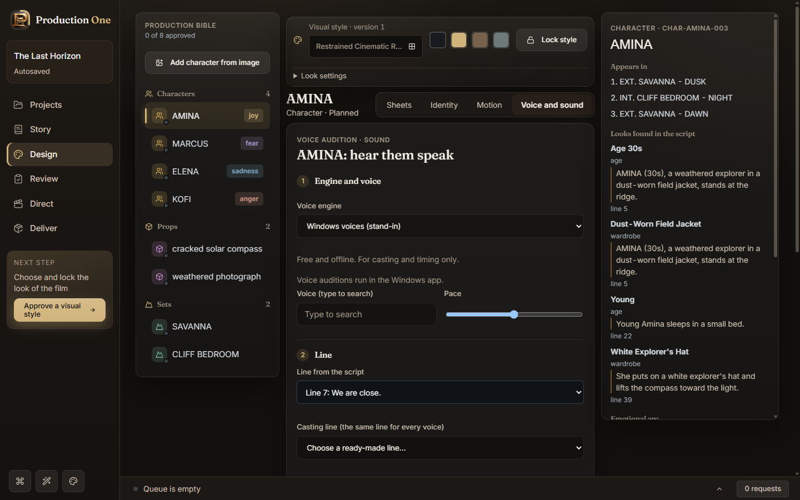

On the **Voice and sound** tab, pick an engine (free Windows voices, ElevenLabs, VoiceKiller, or a local speech server), a voice, and a line. Each character gets its own suggested Windows voice from its stated gender and age.

**Design a voice.** Under the engine, **Fill from the script** writes a voice description from the character's confirmed age, gender, role, personality and sound direction and from their own dialogue, and shows what it was built from; if the script says too little it says what is missing and writes nothing. **Ask the AI helper** has your local model (Ollama or LM Studio) write one from a rough idea; only confirmed fields and the character's lines are sent, and nothing leaves your computer. The description feeds ElevenLabs Voice Design (three previews, then keep one; keeping uses a custom-voice slot) and the Qwen TTS voice field. Chatterbox clones from a recording and cannot design from words, so it shows a note.

**Music with Suno.** Under **Make music with Suno** you can make a theme for the character or the score for a scene they are in. Write the style from the script (stated personality and role, and the scene's heading: where and when), with the AI helper, or by hand; choose the model (V6 Mini, V6, V6 Wild), the length and instrumental or your own lyrics. Each request makes two tracks and spends Kie.ai credits. Suno is reached through Kie.ai, a third-party service, so your text goes to Kie.ai when you press **Make music**; check Kie's and Suno's terms before commercial use. Tracks are saved with the audio clips.

Each clip plays **level-matched** (to -20 LUFS, never boosted past 12 dB or into clipping) with the silence at its two ends trimmed, so voices are compared fairly; the line under the player says what was done. Untick **Level-matched** to hear the original as recorded. Your saved files are never changed.

**Casting line** gives every candidate voice the same words so you compare voices, not wording: a pangram (English; Spanish, French and German letter pangrams), draft lines for Nigerian Pidgin, Yoruba, Igbo and Hausa, or an emotional-range line shaped by the character's personality. The Spanish, French, German and Nigerian-language lines are labelled for a native speaker to check, and the Nigerian-language lines are drafts that were not written by a native speaker. Delivery tags such as `[whispers]` are added only on an ElevenLabs model that reads them (Eleven v3 or later); other engines get plain text.

## The queue

Generation runs in the queue at the bottom, two at a time. **Pause** lets running images finish and holds the rest. Views that match a front view wait until you approve it; the bar says how many are waiting and offers **Open sheets**. If the app closes in the middle of generation, the images that were in flight come back marked *failed, may already be billed* so you can decide whether to retry; waiting images are kept and the queue starts paused.

## Review
**Review** (sidebar, or Alt+6) shows each picture waiting for your decision, large, next to the approved reference it has to match, with a badge in the sidebar for how many wait. Technical checks are listed apart from your decision. **Approve** it; **Request changes** (turns it down and opens its sheet; nothing is generated); or **Reject** (keeps the file; find it again under *Turned down*). You can always change your mind: under *Turned down*, **Approve** a picture you rejected by mistake or press **Not decided** to put it back among those waiting; under *Approved*, **Take back approval** does the same (and an asset whose only approved front view that was loses its Approved label). The same **Undo approval** / **Undo reject** buttons are on every view card in Design and on storyboard frames in Direct, and in the full-size viewer press **U**. Nothing is deleted and nothing is generated by changing a decision. When a view has more than one take, **Other takes** puts two takes side by side (pick which to compare with) and **Keep revision N** approves that one and turns the other down; no file is deleted and nothing is generated. Generation details and the prompt are one click away.

## The Assistant (give it a script or an idea)

The **Assistant** screen (last in the sidebar, also in the command palette) is a chat that plans a production and makes it for you, inside a budget you set.

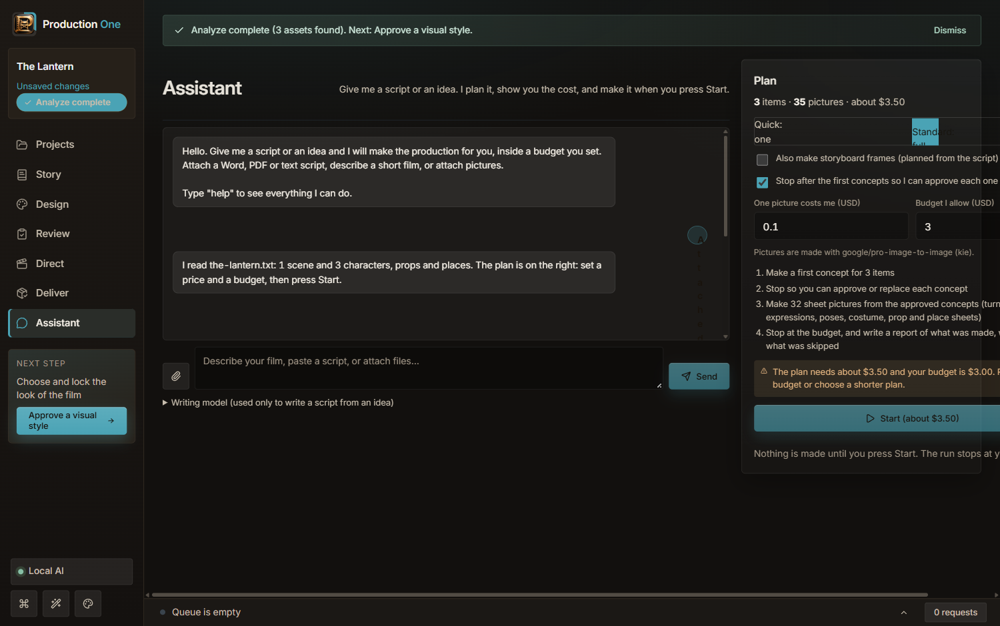

**What you can give it**
- **A script file.** Press the paperclip and choose a Word (.docx), PDF, text, Markdown, Fountain or Final Draft file (up to 12 files). It reads the text and finds the characters, places and props. A scanned PDF has no text to read: run it through OCR first, or paste the text.
- **An idea.** Type a short description of a film. If a Google Gemini or OpenRouter key is saved, it **writes a short script** (4 to 6 scenes) and reads it back; the script is in the Story screen to edit. Without a key it says so and offers to add one. (The writing model is under *Writing model* in the chat and defaults to `gemini-2.5-flash`; this has not been checked with a real model, and a failure says why.)
- **Pictures.** Attach .png, .jpg or .webp files and choose whether they are characters, props, places or costumes: one item per picture, named from the file name, with your picture as the approved reference.
- **A pasted script.** Paste screenplay text and it is read as it is.
Type **help** for the list.

**The plan (right-hand side).** It shows how many items and pictures, and the cost. Choose **Quick** (one sheet each) or **Standard** (turnaround, expressions, poses and costume for a character; multi-view and working views for a prop; establishing, interior and floor plan for a place), whether to also make storyboard frames (in the project's shape, for example 9:16), and enter **what one picture costs you** and **the budget you allow**. It will not start without both, or if the plan costs more than the budget. **Nothing is made until you press Start.**

**The run.** It makes a first concept for every item; then (if you allow it) approves each concept that has no quality notes; then makes the sheets from the approved concepts; then the storyboard frames. The spending guard on the queue is set to your price and budget, so no picture starts past the ceiling, and your previous guard settings come back at the end. **Pause** and **Stop** are always there. Pictures already being made when you press Stop finish; nothing new starts.

**How much it decides.** By default it **stops after the first concepts**: approve, replace or reject each one in Review or Design, then press **Continue**. Untick *Stop after the first concepts* to let it approve a clean concept itself. A concept with quality notes always waits for you. Identity problems start at the concept, which is why stopping there is the default.

**The report** says how many pictures were made, approved (and how many of those it approved itself), waiting for your decision, what failed and why, what was not started, and an **estimate** of what was sent from the price you entered. It is your own estimate, not a bill: check your provider's dashboard.

**What it never does:** change a key or a setting, switch your model or style, spend without a plan you started, or go past the budget.

**Not built yet:** dragging files onto the window, and an MCP server so other agents can drive the app.

## 2D art styles

Production One has a library of **2D styles** (drawn and cel animation, anime-inspired, storybook and painterly, graphic and vector, comics and ink, pixel art). The full list, with every setting, is in [STYLE_CATALOG_2D.md](STYLE_CATALOG_2D.md).

**Choosing one.** Design > the look bar > **Browse styles**. Press the **2D** chip to see only 2D styles, or search by name, family or what it looks like ("pixel", "watercolor", "halftone", "storybook and painterly"). The detail panel shows the style's line, shape language, proportions, palette, shading, texture, edges, the animation approach it suits, **what the app makes**, and a note about image models. Existing styles are all still there; nothing was renamed.

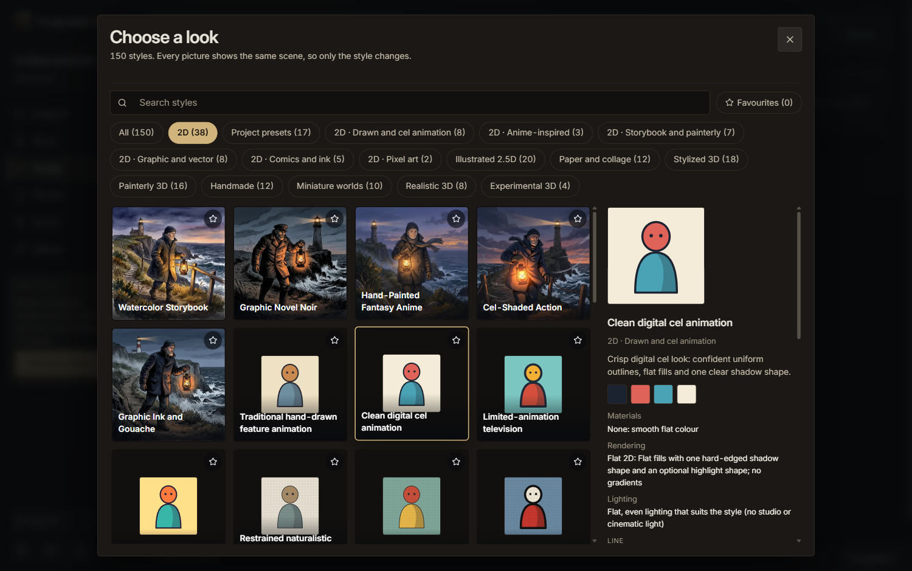

**What a 2D preset is.** Each one is structured settings, compiled into the text sent to the image model: line, shape language, proportions, palette behaviour, shading, texture, perspective, background treatment, edge softness, detail level, an instruction for technical sheets, an instruction for scenes, and a list of things that style must not look like, written for that style (a pixel style says "no anti-aliasing"; flat vector says "no gradients"; watercolour says "no opaque flat vector fills"). Editing the style in **Look settings** (creative direction, materials) changes the request too.

**What the app makes.** One flat 2D **raster** picture per view. It is **not** vector artwork, not a layered file, not a rigged puppet, not an animation file, and not frame-by-frame animation. The "suits" line says which animation approach the look is meant for; the app does not make that animation.

**The preview** in the gallery is a small swatch the app draws from the style's settings (palette, line weight, grain or dots, pixel blocks). It is **not** a picture made by an image model, and the panel says so. It holds no file path, so projects stay portable.

**Honest limits.** Request construction is supported on every image provider here. Five styles (Clean digital cel animation, Watercolor Storybook, Flat vector, Graphic novel, Low-resolution pixel art) were **live-tested once** on one model (Kie.ai `google/pro-image-to-image`, a character front view) and followed their style: see [2D_LIVE_TEST_2026-11-19.md](2D_LIVE_TEST_2026-11-19.md). The other 33 are **not checked**, and no style is checked on any other model: make one view first (**Generate a test**) and look before generating a whole sheet. Pixel art is the least reliable: models often draw soft or inconsistent pixels. The app never switches your model or your style for you.

**No photographic or 3D leakage.** With a 2D style, the request drops the lines that suit a photograph: pores and skin texture, studio light, "neutral white balance", camera lens and depth-of-field wording, "macro". Paper grain, brush and pencil texture that a style *wants* is kept on purpose and is not treated as noise by the quality guidance. The app adds no yellow or neutral colour cast to a 2D style.

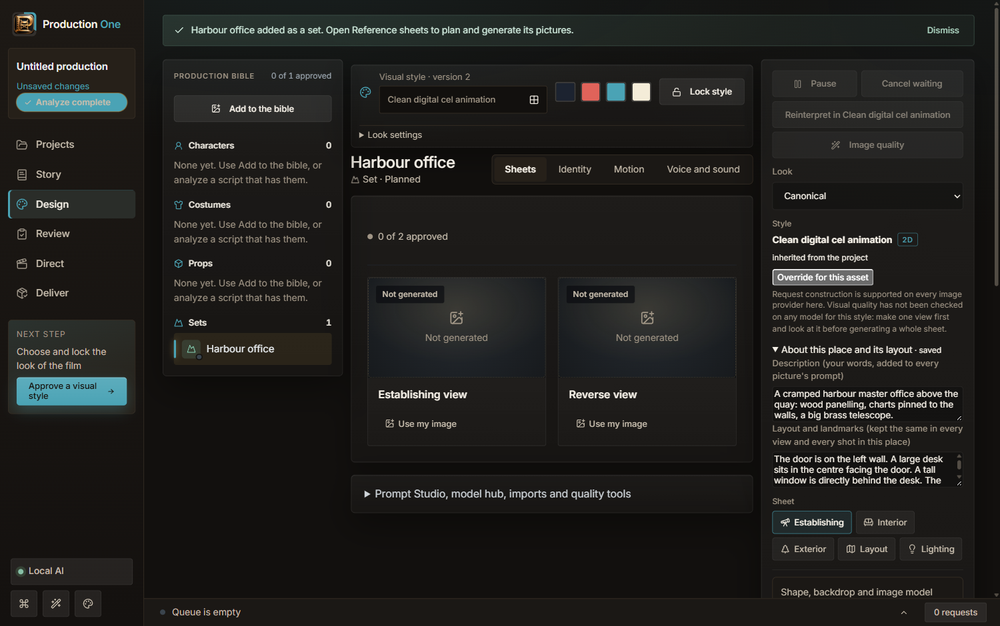

### One style for the project, and a different one for one asset
The project's style applies to every asset. To give one asset its own style, open it in Design and, in the **Style** row of the sheet controls, press **Override for this asset** and choose from the gallery. The row says **inherited from the project** or **your override for this asset**, and **Use the project style** puts it back. A locked project style cannot be changed until you unlock it.

**Changing a style never re-approves anything.** Every picture remembers the style it was made in. After a change, pictures made earlier show **Made in <style>: out of date** and stay exactly as you left them (approved stays approved) until you decide to keep or regenerate them.

### References and style conflicts
A photograph (or any picture in another style) can overpower a 2D style. In a 2D style, attached **reference photos are sent as identity references only** ("who or what it is"), and the request tells the model to redraw them, not copy their lighting, skin or rendering. When the approved picture came from a photo or another style, use **Reinterpret in <style>**: it redraws the approved picture in the selected 2D style as a **new revision for review**. The original picture and its approval are kept. Identity may not carry over exactly, and the app does not claim it will. It uses one image request, and works only with a model that accepts reference images.

### Sheets in 2D
Every sheet type works in a 2D style, drawn from the approved design: identity, turnaround (front, three-quarter, side, rear three-quarter, rear), expressions, poses, wardrobe/costume, detail; props: front/side/back/top, working state, scale, material and damage; places: establishing and reverse, interior, exterior, floor plan, lighting. In 2D the request asks for each view to be **redrawn, not mirrored or flipped** from another view. Technical sheets use a plain flat background that suits the style and no scenery; places fill the frame. Each view is reviewed and approved separately. A character lineup or scale chart across several characters is not built yet.

## Starting from your own idea (no script, no images)
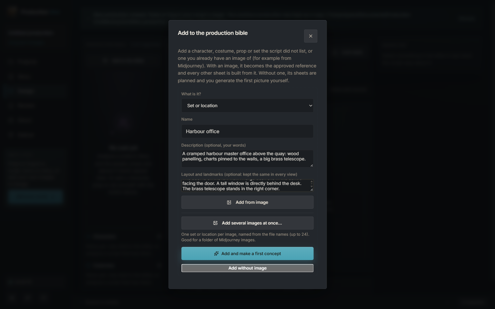

1. Design > **Add to the bible**.
2. Choose what it is: character, costume, prop or set.
3. Type its **name** and a **description** in your own words (the description goes into every picture's request). For a set, also write its **layout and landmarks**.
4. The style is the project's. To use a different one for this asset, press **Override for this asset** afterwards in the sheet controls.
5. Optional references: **Add photos** in the sheet controls (identity references only in 2D styles), or add the asset **from an image** instead.
6. **Add and make a first concept** adds it and makes one picture from your description with the model you chose (one image request). Or **Add** it without a picture and press **Generate** yourself.
7. Look at the concept. **Approve** it, **Use my image** to replace it, or edit the description and try again (**Regenerate**).
8. Once the identity or design is approved, **Generate** the rest of the sheets: they are built from it.
You never need a script for a standalone character, prop or set.

## Places stay the same place
A set has a **Layout and landmarks** field ("About this place and its layout" in the sheet controls, or when you add it): where the door, desk, windows and main props are. It is repeated in **every view of the place** and in **every storyboard shot set there**, with the instruction not to move, add or remove those landmarks. Even with nothing written, every view is told it shows the same architecture and prop positions as the others. Sets never show character fields such as age, gender or ethnicity. A painterly background that differs from the characters is only used where a style says so (for example *Hand-Painted Fantasy Anime*).

## Format (the shape of your pictures and video)

The **Format** choice is on the Projects screen and again in the Director's room. It is one setting for the whole project and is saved in the `.pone` file: **Widescreen 16:9** (default), **Cinema 21:9**, **TikTok / Reels / Shorts 9:16**, **Instagram portrait 4:5**, **Square 1:1**, and **More shapes** (2.39:1, 2:1, 3:2, 4:3, 5:4, 3:4, 2:3).

- Storyboard frames are made in this shape and the cards and previews are drawn in it.
- The video shape on Deliver starts from it. A video model that cannot make that exact shape gets the closest one it can.
- Changing it does not touch frames you already made. They show **Made at <shape>** and the Direct room says how many differ. **Regenerate** remakes one (and costs what a frame costs).
- Image models make only a few shapes, so the app asks for the closest one and then trims the picture to the exact shape. Very wide or tall frames also ask for the subject to sit in the middle.
- Character sheets keep their own shapes (tall for bodies, square for faces).
- See the walkthrough: [GETTING_STARTED.md](GETTING_STARTED.md#choose-your-format-first-instagram-tiktok-cinema).

## Direct (optional)
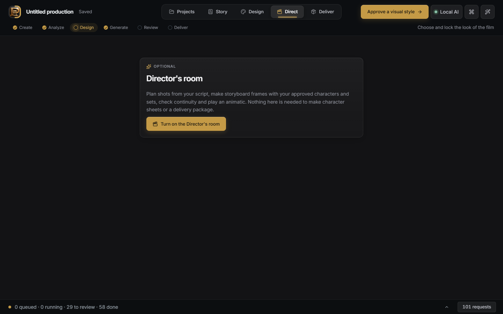

Turn on the Director's room, then **Plan all scenes**. Select a shot to edit it in the sections on the right (drag the edge to resize). **Generate frame** is the main action on a card; the **...** menu has your own image, move, duplicate and delete. Arrow keys move between shots; drag a card to reorder inside its scene. Grid, list and large layouts are in the toolbar. Continuity notes appear under the cards. The animatic plays the frames with dialogue and a temp track. Export the shot list as CSV or Markdown.

## Deliver
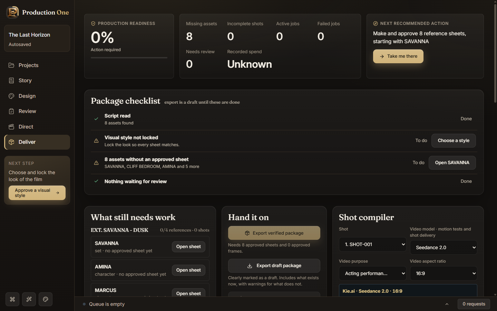

The **package checklist** comes first: script read, style locked, every asset has an approved sheet, nothing waiting for review, failed jobs. Each open line has a button to where it is fixed, and an export is a draft until the list is done. Below it are the hand-off options (verified or draft package, then the optional shot compiler, collapsed when no shots are planned) and the **Tasks** list.

**Failed views by cause.** Under *What still needs work*, views that failed for the same reason are one group: how many, which models, what happened, and only the fixes that can help (**Refresh models**, **Use {your chosen model} for these**, **Choose a model**, **Provider Settings**, **Retry all**). The message for each view is under **Details**, with its own Retry. Retrying sends the views to the provider again and may use credits.

**Tasks** lists the work by role, grouped as Needs approval, Ready or running, Blocked and Complete. Each line says what it is about, why it is where it is, and has a button to the place the work is done; the arrow opens the brief, the evidence it was based on, and what it waits on. The tasks do not run anything: they tell you where to go. The top row shows readiness, what is missing, active and failed jobs and the next action. *What still needs work* lists items by scene with buttons that take you to them. The *Shot compiler* builds the prompt for Seedance, Kling or Veo from the shot's data; you can edit it and copy it. *Export verified package* is available only when every sheet and frame is approved; *draft package* is always available and is marked as a draft.

## Appearance
The palette icon at the bottom of the sidebar opens **Appearance**. Pick a look and it applies at once; each card previews its own colours and heading font.
- **Studio**: calm graphite and champagne (the earlier look).
- **Cinematic** (the default): warm surfaces, serif page titles, a soft tint from your visual style's palette, panels with depth, and the script shown as a page-width column. Its accent comes from the palette, so changing the style changes the accent.
- **Futurist**: near-black blue, a cyan accent with a soft glow, tighter corners.
The same dialog switches dark and light. Your choice is remembered on this computer (until you choose, the app starts in Cinematic) and never changes what anything does. Ctrl+K also has "Appearance: Studio / Cinematic / Futurist".

## Command palette, shortcuts and themes
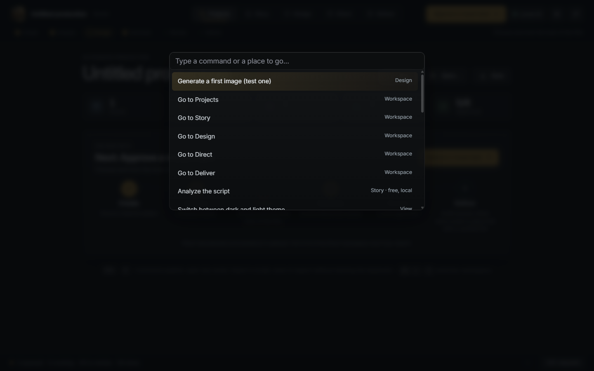

**Ctrl+K** opens the palette. The dark theme is the default; **Switch between dark and light theme** is in the palette and works on every screen.

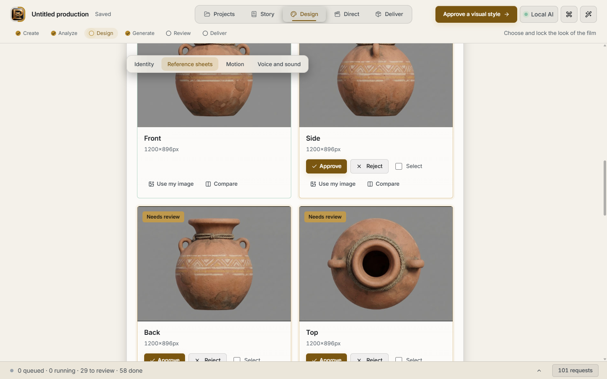

## Providers and local AI
**Providers** stores a key per provider in the Windows credential store. **Local AI** shows Ollama, LM Studio and ComfyUI, what your GPU can run, and can install ComfyUI and download SDXL and Wan 2.2 5B (large downloads, resumable). Local models appear in the same model picker.

## Cost
Cloud models bill at the provider. The small counter in the queue dock counts requests; switch on a cap there with your own price per request if you want one. The app never states a price of its own.

## Troubleshooting
| Symptom | Fix |
|---|---|
| "401" or "invalid key" | The provider rejected the key: re-enter it in Providers (check for extra characters or capitals). |
| A view stays *Queued* | It waits for the approved front view (the queue bar says so), or the queue is paused, or a spending cap is on. |
| "Kie has no model page called ..." | Kie sometimes refuses a model it served minutes ago. The app retries it after a pause; if it keeps failing, press **Refresh models**. |
| Nothing generates in the browser preview | Generation runs in the Windows app. |
| Word/PDF import says no text | The PDF is a scan; run OCR first or paste the text. |
| ComfyUI "not running" | Open Local AI and press Start. |
| I opened a project and lost the one I had | Look in `Documents\Production One\Backups`; the app saved a copy first. |

### Batch voice and music
Under the Voice and sound section, **Batch** casts several characters or scores several themes and scenes at once.
- **Voices:** choose an engine, tick the characters and choose a voice for each (cloud engines: press *Load my voices* once). Each speaks the first line the script gives them, or a line you type in the Line box.
- **Music:** tick character themes and scene scores. Each is built from the personality, role and scene heading the script states (Suno V6 Mini through Kie.ai, instrumental, about 45 seconds). A theme with no stated personality or role is skipped, and the list says why.
- **Cost first:** the line under the table says what the batch will spend. Windows voices and speech servers on your network cost nothing; ElevenLabs and VoiceKiller are billed by characters, Suno by request (two tracks each). The app does not know prices: type yours and it shows a dollar figure. **Review and make** shows the list; nothing is sent until you press the confirming button, which says "Spend credits" when it will spend any. A paid batch is limited to 20 items; **Stop after this one** is available while it runs, and a key or credit problem stops the batch.
- Results are saved with the audio clips, like a single audition.

### A voice for each character
In the single audition, choose an engine and voice, then **Save as this character's voice**. From then on that character opens with that engine and voice, the batch panel fills it in (**Tick them** ticks everyone who has one), and it is saved with the project. **Clear** removes it. In the batch panel, **Remember the chosen voices** saves the voices of every ticked character at once. A saved voice is only offered to the engine it belongs to.

### Try it with the sample film
`samples/the-renewal.fountain` is a short film (THE RENEWAL, the Bureau of Infernal Affairs) with three characters, props and four locations; `samples/WORLD_BUREAU_OF_INFERNAL_AFFAIRS.md` describes its world. Paste or import the script and press Analyze to see the reader at work. The project is named from the script's title while it still has a placeholder name.

### Moving a project to another computer
**Save** (and **Save As**) put a folder next to the project file, named after it (`film_files` beside `film.pone`), with every picture, sound and clip the project uses. Move the `.pone` file and its `_files` folder together. When the project is opened, anything missing on that computer is found in the folder and copied back into the app. Autosave does not copy files; an explicit Save does, so press Save before you copy the project.

### New views that keep the backdrop of your own front view
On a sheet, **Backdrop** can be **Same as my front view (colour and lighting)**. The app reads the colour of your approved front view's background and asks every new view to keep it: the same colour, the same soft lighting, nothing added. It needs an approved front view; until there is one, flat grey is used. Views already made keep their own backdrop. **Flat grey**, **Flat white** and **Match the reference image (flat tone)** are still there when you want one plain field for every view.
